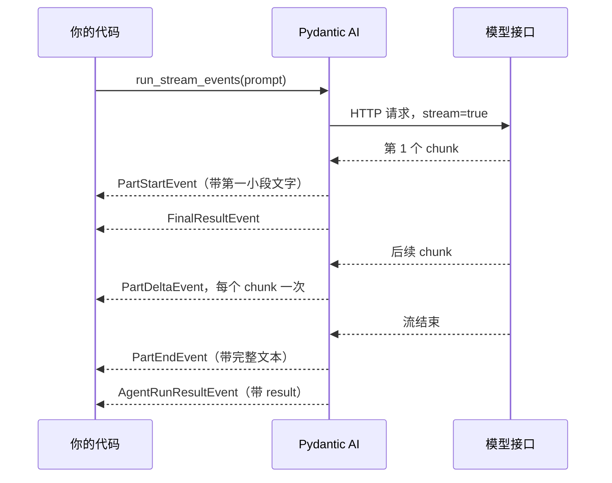
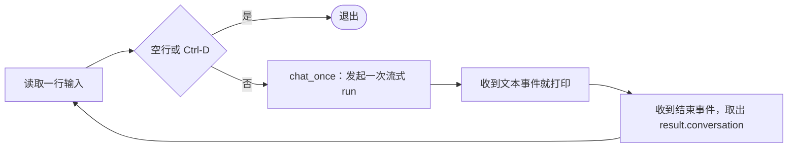
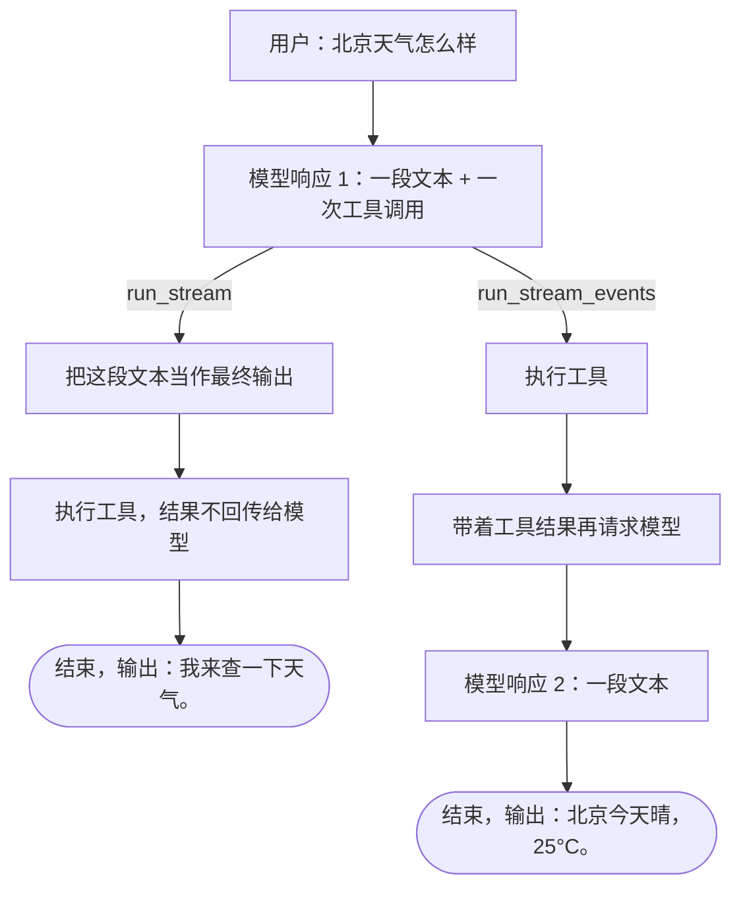

# 02 流式输出

[← 返回总目录](../../README.md)

上一章的 `run` 要等模型把话说完才返回。这一章让文字边生成边到达。三个示例依次回答三个问题：

| 示例 | 回答的问题 |
|---|---|
| [01_stream_text.py](./01_stream_text.py) | 怎么用最少的代码做出打字机效果？ |
| [02_stream_events.py](./02_stream_events.py) | 除了文本，一次 run 的过程中还发生了什么？ |
| [03_chat_repl.py](./03_chat_repl.py) | 流式和多轮对话怎么结合成一个能用的聊天程序？ |

基于 Pydantic AI 2.73.0。文中的输出都是实际运行结果，模型回答的具体文字每次会不同。

## 1. 心智模型

流式不改变 run 的结果，只改变你拿到结果的时机：

```
run                 等全部生成完，一次性返回 result
run_stream          边生成边给你「最终输出」这一样东西（文本或结构化对象）
run_stream_events   边生成边给你「过程中的每一个事件」，最后一个事件里带着 result
```

后两个的区别是抽象层次不同，不是新旧之分：

| Pydantic AI | JS / Rust 里像什么 |
|---|---|
| `agent.run(...)` | `await fetch(url).then(r => r.text())`，等整个 body |
| `agent.run_stream(...)` | 把 `response.body` 当成一条纯文本流来读 |
| `agent.run_stream_events(...)` | Vercel AI SDK 的 `fullStream`；或 Rust 里一条 `Stream<Item = Event>`，`Event` 是个 enum，用 `match` 分发 |

一次不带工具的流式 run，时间线是这样的：



要记住的只有一句：**模型的一条响应由若干个 part 组成，每个 part 按「开始 → 若干增量 → 结束」的顺序到达**。part 就是上一章消息结构里的 `TextPart`、`ThinkingPart`、`ToolCallPart`，流式只是把它们拆开来送。

## 2. 前置知识

### 2.1 流式在协议层是什么

你在前端接过 SSE，这里是同一个东西：请求里带上 `stream: true`，服务端保持连接，一小段一小段往回推。各家的分片格式不一样（下面是示意，省略了无关字段）：

```
# OpenAI 规范：只有增量，没有显式的开始和结束
data: {"choices":[{"delta":{"content":"流式"}}]}
data: {"choices":[{"delta":{"content":"输出"}}]}
data: [DONE]

# Anthropic 规范：每个 content block 有明确的 start / delta / stop
event: content_block_start
event: content_block_delta
event: content_block_stop
```

Pydantic AI 的 Model 层把它们统一翻译成同一套事件。所以本章的代码不用关心底下走的是哪种协议，这也是上一章说的「Model 负责协议」的又一个体现。

每个 chunk 有多大由模型和中转站决定。本项目默认的模型一次给一大段，看起来是一段一段跳出来，而不是逐字出现。

### 2.2 本章用到的 Python 语法

| 写法 | 含义 | JS / Rust 对照 |
|---|---|---|
| `async with f() as x:` | 异步上下文管理器：进入和退出时各执行一段可以 `await` 的逻辑，退出逻辑在异常时也会执行 | `try { ... } finally { await x.close() }`；Rust 的 RAII guard，区别是这里的清理可以是异步的 |
| `async for x in stream:` | 遍历异步迭代器，每取一项都可能挂起等待 | `for await (const x of stream)` / `while let Some(x) = stream.next().await` |
| `print(s, end="", flush=True)` | `end=""` 不换行；`flush=True` 立刻刷到终端，否则会攒在缓冲区里，看不出流式效果 | `process.stdout.write(s)` / `print!` 后接 `stdout().flush()` |
| `match event:` + `case Cls(attr=p):` | 结构化模式匹配。`Cls(...)` 在这里不是创建对象，而是「是这个类的实例，并且属性匹配」 | Rust 的 `match`，`Event::PartStart { part }` 这种解构 |
| `case A(part=B(content=content)):` | 嵌套匹配，同时把最里层的属性绑定到变量 `content` | `Event::PartStart { part: Part::Text { content } }` |
| `case ... if cond:` | 守卫：模式匹配上之后还要满足条件 | Rust 的 match guard |
| `case _:` | 兜底分支 | `_ =>` / `default:` |
| `Conversation \| None` | 联合类型，表示可以为空 | `Conversation \| null` / `Option<Conversation>` |
| `try: ... except EOFError:` | 捕获指定类型的异常。终端里按 Ctrl-D 时 `input` 会抛 `EOFError` | `try / catch` 里判断错误类型 |
| `"\\[文本开始]"` | `rich` 把 `[...]` 当样式标记，想输出字面的 `[` 要写成 `\[`，在 Python 字符串里就是 `\\[` | |

`match` 的分支从上往下尝试，命中第一个就停，和 Rust 一样。区别是 Python 不检查是否穷尽，漏掉的情况会静默跳过，所以示例里都写了 `case _:`。

## 3. 示例讲解

### 3.1 [01_stream_text.py](./01_stream_text.py)：流式文本

```bash
uv run examples/02_streaming/01_stream_text.py
```

```python
async with agent.run_stream("用三句话介绍一下流式输出（SSE）的原理") as response:
    # debounce_by=None：收到一个 chunk 就立刻给出，不做合并
    async for delta in response.stream_text(delta=True, debounce_by=None):
        print(delta, end="", flush=True)
    print()
    # 流结束后才有完整的用量
    console.print(f"[dim]用量：{response.usage}[/]")
```

要点：

- **`run_stream` 必须配 `async with` 用。** 进入时发出请求，退出时关闭连接。`response` 是 `StreamedRunResult`，和上一章的 `result` 很像，区别是它的内容还在陆续到达。
- **`stream_text()`** 返回一个异步迭代器，每次产出一段文本。两个参数决定了产出的形式：

| 参数 | 默认值 | 含义 |
|---|---|---|
| `delta` | `False` | `True`：每次只给新增的部分。`False`：每次给到目前为止的完整文本 |
| `debounce_by` | `0.1` | 把这么多秒内到达的 chunk 合并成一次产出。`None` 表示不合并 |

同一段回复在三种组合下的产出（用每 20ms 吐一个字的假模型实测）：

```
delta=True,  debounce_by=None  →  '一', '二', '三', '四', '五', '六', '七', '八'
delta=True                     →  '一二三四五', '六七八'
delta=False, debounce_by=None  →  '一', '一二', '一二三', '一二三四', ...
```

怎么选：

| 场景 | 用法 |
|---|---|
| 终端打印，往后追加 | `delta=True`，这样直接 `print` 就行 |
| 前端整段替换（`setText(text)`） | `delta=False`，每次拿到的就是当前完整内容，不用自己拼 |
| 想要最顺滑的逐字效果 | `debounce_by=None` |
| 每次产出都要触发较重的操作（渲染、校验） | 保留默认的合并，减少触发次数 |

- **用量要等流读完才完整。** 流还没读完时 `response.usage` 是 `RunUsage(requests=1)`，token 数是 0。所以打印用量的那一行放在 `async for` 之后。

实际输出：

```
───────── 01 stream text  openai-relay · gemini-3.1-flash-lite-preview ─────────
1. **持久连接**：客户端向服务器发送一个特殊的 HTTP 请求，服务器接收后不立即断开连接，而是保持这个 TCP 通道处于开启状态。
2. **文本传输**：服务器利用这个持续打开的通道，以固定的 `text/event-stream` 格式，分块、源源不断地向客户端主动推送文本数据。
3. **单向接收**：客户端通过监听这个连接上的“消息事件”（Message），在浏览器或应用中实时接收并渲染这些增量数据，直到服务器主动关闭连接或传输结束。
用量：RunUsage(details={...}, input_tokens=40, output_tokens=244, requests=1)
```

打印增量用的是内置的 `print`，不是 `console.print`。原因有两个：`console.print` 默认会换行；它还会把模型输出里的 `[...]` 当成样式标记去解析，原文可能被吃掉一部分。

### 3.2 [02_stream_events.py](./02_stream_events.py)：完整事件流

```bash
uv run examples/02_streaming/02_stream_events.py
```

`run_stream` 只给你最终输出。`run_stream_events` 把过程中发生的每件事都作为一个事件给你：

```python
async with agent.run_stream_events("9.11 和 9.9 哪个大？简短说明理由。") as events:
    async for event in events:
        match event:
            case PartStartEvent(part=TextPart(content=content)):
                console.print("[cyan]\\[文本开始][/]")
                print(content, end="", flush=True)
            case PartStartEvent(part=ThinkingPart(content=content)):
                console.print("[magenta]\\[思考开始][/]")
                print(content, end="", flush=True)
            case PartDeltaEvent(delta=TextPartDelta(content_delta=delta)):
                print(delta, end="", flush=True)
            case PartDeltaEvent(delta=ThinkingPartDelta(content_delta=delta)) if (
                delta
            ):
                print(delta, end="", flush=True)
            case PartEndEvent():
                print()
            case FinalResultEvent():
                # 纯文本输出时，它紧跟在第一个文本 part 开始之后，所以标记打在行内
                console.print("[green]⟨最终结果⟩[/]", end="")
            case AgentRunResultEvent(result=result):
                console.print(f"[dim]\\[结束] 用量：{result.usage}[/]")
            case _:
                # 其他事件（工具调用等）在后面的章节再处理
                pass
```

#### 五种事件

| 事件 | 什么时候出现 | 上面带着什么 |
|---|---|---|
| `PartStartEvent` | 一个新的 part 开始 | `part`：刚开始的 part，里面可能已经有第一小段内容 |
| `PartDeltaEvent` | 这个 part 来了一段增量 | `delta`：`TextPartDelta`、`ThinkingPartDelta` 或 `ToolCallPartDelta` |
| `PartEndEvent` | 这个 part 结束 | `part`：完整的 part |
| `FinalResultEvent` | 当前这条响应的内容符合输出类型，可以作为结果 | `tool_name`：纯文本输出时是 `None` |
| `AgentRunResultEvent` | 整个 run 结束，最后一个事件 | `result`：和 `agent.run()` 返回的是同一种对象 |

前三个事件上都有 `index`，表示这是响应里的第几个 part。一条响应里有多个 part（比如先思考再回答）时，靠它区分。

把一次真实 run 的事件原样打印出来（问题是「用一句话说明什么是 SSE。」，长文本用 … 省略）：

```
PartStartEvent(index=0, part=TextPart(content='**SSE'))
FinalResultEvent(tool_name=None, tool_call_id=None)
PartDeltaEvent(index=0, delta=TextPartDelta(content_delta='**（Server-Sent Events，服务器发送事件）是一种…'))
PartDeltaEvent(index=0, delta=TextPartDelta(content_delta='允许浏览器通过 HTTP 连接自动接收来自服务器的实时数据更新。'))
PartEndEvent(index=0, part=TextPart(content='**SSE**（Server-Sent Events，服务器发送事件）是一种…实时数据更新。'))
AgentRunResultEvent(result=AgentRunResult(output='**SSE**（Server-Sent Events，服务器发送事件）是一种…实时数据更新。'))
```

对照第 1 节的时序图，能读出三件事：

- **第一小段文字在 `PartStartEvent` 里**，不在 `PartDeltaEvent` 里。只处理 delta 会丢掉开头的 `**SSE`。
- **`PartEndEvent` 和 `AgentRunResultEvent` 都带完整文本。** 不需要打字机效果、只想在结束时拿全文的话，不用自己拼 delta。
- **`FinalResultEvent` 很早就出现了**，它不是结束信号，见 [4.5](#45-finalresultevent-不是结束信号)。

#### 几个分支的写法

- **两个 `PartStartEvent` 分支靠 `part` 的类型区分。** 第一个只匹配文本 part，第二个只匹配思考 part。工具调用的 part 两个都不匹配，落到 `case _:`。
- **`ThinkingPartDelta` 那个分支带了 `if delta` 守卫。** 思考的增量有时只带签名、不带文字，这时 `content_delta` 是 `None`，要跳过。
- **`PartEndEvent()` 的括号里什么都不写**，意思是只要是这个类的实例就匹配，不关心属性。

实际输出：

```
──────── 02 stream events  openai-relay · gemini-3.1-flash-lite-preview ────────
[文本开始]
**9⟨最终结果⟩.9 大**。

**理由**：比较两个小数的大小，先看整数部分，整数部分都是9，所以比较十分位。9.11的十分位是1，而9.9的十分位是9（相当于9.90）。因为9大于1，所以9.9更大。
[结束] 用量：RunUsage(details={...}, input_tokens=46, output_tokens=138, requests=1)
```

`⟨最终结果⟩` 插在 `**9` 和 `.9 大` 之间，正好印证了事件顺序：`PartStartEvent` 带着第一小段 `**9` 先到，然后是 `FinalResultEvent`，再往后才是各个 delta。

这次运行没有出现 `[思考开始]`，因为这个模型没有返回思考内容。`ThinkingPart` 的分支只有在模型返回思考内容时才会触发。

### 3.3 [03_chat_repl.py](./03_chat_repl.py)：流式多轮聊天

```bash
uv run examples/02_streaming/03_chat_repl.py
```

把本章的事件流和上一章的 `conversation` 拼在一起，就是一个最小的终端聊天程序：

```python
async def chat_once(prompt: str, conversation: Conversation | None) -> Conversation:
    async with agent.run_stream_events(prompt, conversation=conversation) as events:
        async for event in events:
            match event:
                case PartStartEvent(part=TextPart(content=content)):
                    print(content, end="", flush=True)
                case PartDeltaEvent(delta=TextPartDelta(content_delta=delta)):
                    print(delta, end="", flush=True)
                case AgentRunResultEvent(result=result):
                    print()
                    return result.conversation
                case _:
                    pass
    raise RuntimeError("事件流结束时没有收到最终结果")


async def main() -> None:
    conversation: Conversation | None = None
    while True:
        try:
            prompt = console.input("[bold green]你> [/]").strip()
        except EOFError:
            break
        if not prompt:
            break
        conversation = await chat_once(prompt, conversation)
```



要点：

- **状态只有一个变量 `conversation`。** 第一轮是 `None`，表示新对话；之后每一轮都把上一轮返回的值传进去。Agent 仍然是无状态的，和上一章的 04 示例是同一个模型，只是把 `run_sync` 换成了流式。
- **`chat_once` 只处理三种事件。** 文本的开始和增量用来打印，结束事件用来取 `conversation`。`PartEndEvent` 这里用不到，因为换行放在了结束事件里。
- **最后的 `raise RuntimeError` 正常情况下走不到。** `AgentRunResultEvent` 一定是最后一个事件，函数会在那里 `return`。保留这一行是为了让类型检查器确认每条路径都有返回值，同时在事件流异常结束时报出明确的错误。
- **`console.input`** 是 `rich` 版的 `input`，提示符可以带样式。

实际输出：

```
────────── 03 chat repl  openai-relay · gemini-3.1-flash-lite-preview ──────────
你> 我叫小明，在学 Rust。
你好，小明！很高兴见到你。Rust 是一门非常强大且有趣的语言。

有什么关于 Rust 的问题需要我帮忙吗？
你> 我叫什么？在学什么？
你叫小明，在学 Rust。
你>
```

第二轮的问题里没有提名字和 Rust，模型能答上来，说明第一轮的问答通过 `conversation` 带进了第二次请求。

## 4. 进阶与踩坑

### 4.1 三个方法怎么选

| 场景 | 用哪个 |
|---|---|
| 不需要流式（后台任务、批处理） | `run` |
| 不带工具，只要打字机效果 | `run_stream` + `stream_text()` |
| 结构化输出，想边生成边拿到部分对象（第 3 章） | `run_stream` + `stream_output()` |
| Agent 带工具 | `run_stream_events` |
| 界面上要展示思考过程、「正在调用某某工具」 | `run_stream_events` |

真实项目里的 Agent 基本都带工具，所以 `run_stream_events` 是更常用的那个。原因见下一条。

### 4.2 带工具时 `run_stream` 会提前结束

带工具之后，一次 run 是一个循环：请求模型、执行工具、带着工具结果再请求模型，直到模型给出最终回答。`run_stream` 把**第一段符合输出类型的内容**当作最终输出，不会继续这个循环。

模型经常先说一句话再调工具。用 Pydantic AI 自带的假模型 `FunctionModel` 固定住这个行为（第一条响应是文本「我来查一下天气。」加一次 `get_weather` 调用），实测两个方法的结果：

| | 最终输出 | 模型请求次数 | 工具函数 |
|---|---|---|---|
| `run_stream` | 我来查一下天气。 | 1 | 执行了 1 次，但结果没有回传给模型 |
| `run_stream_events` | 北京今天晴，25°C。 | 2 | 执行了 1 次 |



用 `run_stream` 时用户只会看到「我来查一下天气。」，然后就没有下文了。它不报错，而且只在模型恰好先说话再调工具时才出现，很难排查。

同一个场景下 `run_stream_events` 的完整事件序列如下，中间多出来的两个事件就是工具的调用和返回：

```
PartStartEvent(index=0, part=TextPart(content='我来查一下天气。'))
FinalResultEvent(tool_name=None, tool_call_id=None)
PartEndEvent(index=0, part=TextPart(...), next_part_kind='tool-call')
PartStartEvent(index=1, part=ToolCallPart(tool_name='get_weather', args='{"city": "北京"}', ...))
PartEndEvent(index=1, part=ToolCallPart(...))
FunctionToolCallEvent(part=ToolCallPart(tool_name='get_weather', ...))
FunctionToolResultEvent(part=ToolReturnPart(tool_name='get_weather', content='北京：晴，25°C', ...))
PartStartEvent(index=0, part=TextPart(content='北京今天晴，25°C。'))
FinalResultEvent(tool_name=None, tool_call_id=None)
PartEndEvent(index=0, part=TextPart(content='北京今天晴，25°C。'))
AgentRunResultEvent(result=AgentRunResult(output='北京今天晴，25°C。'))
```

这段实验用的脚本不在本章示例里，工具的正式用法在后面的章节讲。本章三个示例都不带工具，所以两个方法都能正常工作。

### 4.3 默认有 0.1 秒的合并

`stream_text()` 不传 `debounce_by` 时，会把 0.1 秒内到达的 chunk 合并成一次产出。如果觉得流式一顿一顿的，先检查是不是没传 `debounce_by=None`。

这个参数只存在于 `run_stream` 的几个 `stream_*` 方法上。`run_stream_events` 不做合并，模型来一个 chunk 就给一个事件。

### 4.4 流没读完，就没有完整结果

`run_stream` 的 `response` 上，有些东西要等流读完才能用：

| | 流读完之前 | 流读完之后 |
|---|---|---|
| `response.usage` | `RunUsage(requests=1)`，token 数是 0 | 完整用量 |
| `response.is_complete` | `False` | `True` |
| `response.result` | 抛 `UserError` | 一个 `AgentRunResult`，和 `run()` 返回的一样 |
| `response.all_messages()` | 不含这一轮的模型响应 | 完整 |

「读完」指的是把 `stream_text()` 等迭代器遍历到底，或者调用 `await response.get_output()`。如果在 `async for` 里提前 `break`，或者进入 `async with` 后什么都不读就退出，这次回复不会进入消息历史。

不关心中间过程、只想拿最终输出时，可以直接 `await response.get_output()`，它会把流读完并返回完整输出。

### 4.5 `FinalResultEvent` 不是结束信号

它的含义是「当前这条响应的内容符合输出类型，可以作为结果」，在第一小段文字到达后就会出现，这时文本才刚开始生成。带工具时它还会出现不止一次：[4.2](#42-带工具时-run_stream-会提前结束) 的事件序列里就有两个，第一个对应的文本并不是最终回答。

判断 run 结束只看 `AgentRunResultEvent`。

### 4.6 提前退出事件流会取消整个 run

`run_stream_events` 的 run 在后台任务里执行，有两个容易意外的行为：

- **惰性启动。** 进入 `async with` 时还没有发请求，第一次迭代才开始。进入后不迭代就退出，模型一次都不会被调用。
- **提前退出等于取消。** 在 `async for` 里 `break`，或者中途抛异常离开 `async with`，后台的 run 会被取消，`events.result` 是 `None`。

所以 03 示例是在收到 `AgentRunResultEvent` 之后才 `return` 的，这时 run 已经完整结束。

### 4.7 `run_stream` 也能做多轮

03 示例用的是 `run_stream_events`，因为结束事件里直接带着 `result`。不带工具时用 `run_stream` 也可以，流读完之后从 `response.result` 上取：

```python
async with agent.run_stream(prompt, conversation=conversation) as response:
    async for delta in response.stream_text(delta=True, debounce_by=None):
        print(delta, end="", flush=True)
    conversation = response.result.conversation   # 必须在流读完之后
```

### 4.8 同步代码里的流式

普通同步脚本里可以用 `run_stream_sync`，写法是普通的 `with` 和 `for`：

```python
with agent.run_stream_sync("问题") as response:
    for delta in response.stream_text(delta=True, debounce_by=None):
        print(delta, end="", flush=True)
```

它和 `run_sync` 有同样的限制，不能在已经有事件循环的地方用，见上一章的 [4.1](../01_basic_call/README.md#41-run_sync-不能在异步代码里用)。

## 5. 速查

```python
from pydantic_ai import (
    Agent, AgentRunResultEvent, PartDeltaEvent, PartStartEvent, TextPart, TextPartDelta,
)

# 流式文本（不带工具时）
async with agent.run_stream("问题") as response:
    async for delta in response.stream_text(delta=True, debounce_by=None):
        print(delta, end="", flush=True)
    response.usage                    # 流读完后才完整
    response.result.conversation      # 流读完后才能取

# 不要中间过程，只要最终输出
async with agent.run_stream("问题") as response:
    output = await response.get_output()

# 完整事件流（带工具时用这个）
async with agent.run_stream_events("问题", conversation=conversation) as events:
    async for event in events:
        match event:
            case PartStartEvent(part=TextPart(content=content)):
                print(content, end="", flush=True)        # 第一小段文字在这里
            case PartDeltaEvent(delta=TextPartDelta(content_delta=delta)):
                print(delta, end="", flush=True)
            case AgentRunResultEvent(result=result):
                conversation = result.conversation        # 传给下一轮
            case _:
                pass
```

| 概念 | 一句话 |
|---|---|
| `run_stream` | 只流式给出最终输出；第一段符合输出类型的内容就算最终输出 |
| `run_stream_events` | 跑完整个 run，把每个事件都给你；带工具时用它 |
| part 的生命周期 | `PartStartEvent` → 若干 `PartDeltaEvent` → `PartEndEvent` |
| 第一小段文字 | 在 `PartStartEvent` 里，不在 delta 里 |
| `FinalResultEvent` | 「这条响应可以作为结果」，不是结束信号 |
| `AgentRunResultEvent` | run 结束，最后一个事件，带 `result` |
| `delta=True` / `False` | 只给新增部分 / 给到目前为止的完整文本 |
| `debounce_by` | 默认合并 0.1 秒内的 chunk，`None` 表示不合并 |

---

上一章：[01 基础调用](../01_basic_call/README.md) ｜ 下一章：[03 结构化输出](../03_structured_output/README.md)
