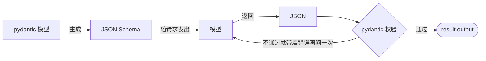
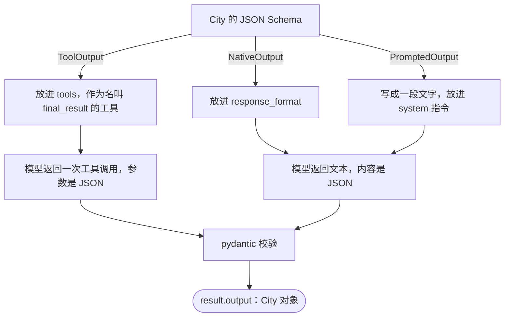
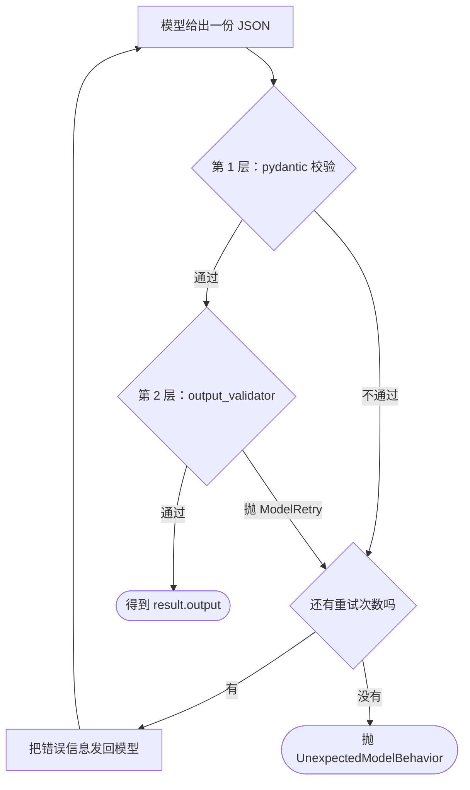
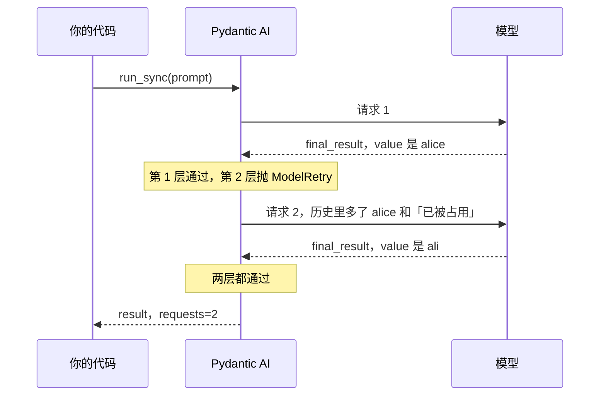
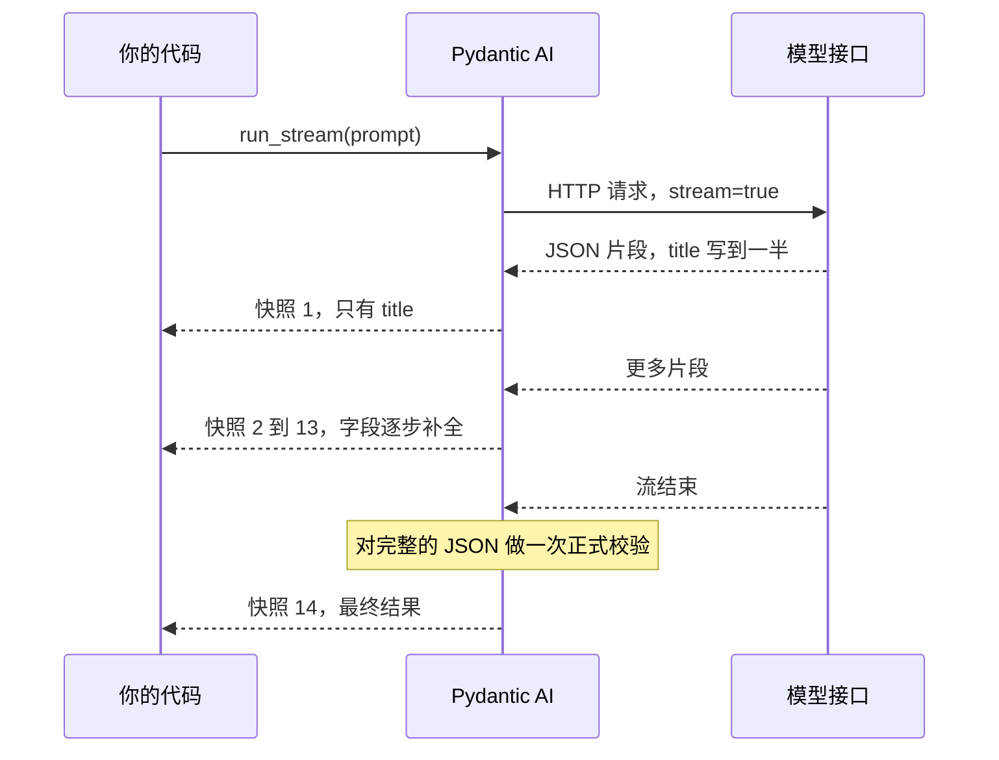

# 03 结构化输出

[← 返回总目录](../../README.md)

前两章拿回来的都是一段文字。这一章让模型返回一个字段固定、校验过的对象，代码可以直接取字段用，不用再从文字里解析。四个示例依次回答四个问题：

| 示例 | 回答的问题 |
|---|---|
| [01_basic.py](./01_basic.py) | 怎么让模型返回一个类型确定的对象？ |
| [02_output_modes.py](./02_output_modes.py) | 格式要求是通过什么渠道交给模型的？当前接口支持哪几种？ |
| [03_validator_retry.py](./03_validator_retry.py) | 模型给的结果不合格怎么办？ |
| [04_stream_structured.py](./04_stream_structured.py) | 对象还没生成完，能不能先拿到一部分？ |

基于 Pydantic AI 2.73.0。文中的输出都是实际运行结果（省略了开头的标题行），模型回答的具体文字每次会不同。

## 1. 心智模型

结构化输出只是给 Agent 多配了一个 `output_type`。围绕它有四样东西：

```
output_type     你写的 pydantic 模型                       → 类型定义
JSON Schema     框架从模型定义生成，随请求发给模型           → 给模型看的格式要求
JSON            模型按要求写出来的数据                      → 不可信的外部输入
result.output   框架用同一个 pydantic 模型校验后得到的对象    → 可信的、有类型的数据
```



用熟悉的东西类比：

| Pydantic AI | JS / Rust 里像什么 |
|---|---|
| `class Order(BaseModel)` | zod 的 `z.object({...})`；Rust 里 `#[derive(Deserialize, JsonSchema)]` 的 struct |
| `Agent(model, output_type=Order)` | Vercel AI SDK 的 `generateObject({ schema })` |
| `result.output` | `schema.parse(json)` 的返回值；`serde_json::from_str::<Order>(..)?` 的结果 |
| `response.stream_output()` | Vercel AI SDK `streamObject` 的 `partialObjectStream` |
| 校验失败自动重试 | 自己写的循环：解析失败就把报错拼进消息，再问一次 |

要记住的只有一句：**同一个 pydantic 模型被用了两次，发请求前用它生成 schema 告诉模型要什么，收到响应后用它校验模型给了什么**。模型的输出和用户提交的表单一样，是不可信的外部输入。schema 是要求，校验才是保证。

## 2. 前置知识

### 2.1 pydantic 速览

pydantic 是 Python 里做「数据定义 + 校验」的库，Pydantic AI 的名字就来自它。继承 `BaseModel` 的类，类体里每个带类型注解的属性就是一个字段：

```python
class LineItem(BaseModel):
    name: str
    quantity: int
    unit_price: float = Field(description="单价，单位：元")
```

第 1 章说过类型注解只给类型检查器看，运行时不校验。pydantic 是例外：它在创建对象时会读取这些注解，真的去校验数据。本项目的 [config.py](../../src/agentkit/config.py) 读 `providers.toml` 时用的 `Profile.model_validate(...)` 就是它。

常用的几个方法：

| 写法 | 作用 | JS / Rust 对照 |
|---|---|---|
| `Order.model_validate(data)` | dict → 对象，不合法时抛 `ValidationError` | zod 的 `schema.parse(data)` |
| `Order.model_validate_json(text)` | JSON 字符串 → 对象 | `serde_json::from_str::<Order>(text)` |
| `order.model_dump()` | 对象 → dict | `serde_json::to_value(&order)` |
| `order.model_dump_json()` | 对象 → JSON 字符串 | `JSON.stringify(order)` / `serde_json::to_string(&order)` |
| `Order.model_json_schema()` | 生成 JSON Schema | zod 的 `z.toJSONSchema(schema)` / `schemars::schema_for!(Order)` |

校验有两个特点，后面都会用到：

- **默认是宽松模式。** 能无损转换的会直接转，转不了才报错。`quantity` 给 `"3"` 得到 `3`，`unit_price` 给 `399` 得到 `399.0`。
- **报错是结构化的。** 一次列出所有问题，每个问题带着位置、原因和原始输入（下面省略了每条后面的文档链接）：

```
2 validation errors for Order
items.0.quantity
  Input should be a valid integer, unable to parse string as an integer [type=int_parsing, input_value='三个', input_type=str]
urgency
  Input should be 'low', 'normal' or 'high' [type=literal_error, input_value='urgent', input_type=str]
```

模型给的数据通不过校验时，发回给模型的就是这些信息，所以模型能知道自己错在哪。见 3.3。

### 2.2 JSON Schema：模型实际看到的东西

模型看不到 Python 类，它看到的是由类生成的 JSON Schema。01 示例的 `Order` 发出去时是这样的（本地 mock 抓取，`$defs` 里 `LineItem` 的定义省略）：

```json
{
  "properties": {
    "customer": { "type": "string" },
    "items": { "items": { "$ref": "#/$defs/LineItem" }, "type": "array" },
    "urgency": {
      "description": "根据语气判断紧急程度",
      "enum": ["low", "normal", "high"],
      "type": "string"
    },
    "note": {
      "default": null,
      "description": "客户的额外要求，没有则为空",
      "anyOf": [{ "type": "string" }, { "type": "null" }]
    }
  },
  "required": ["customer", "items", "urgency"],
  "type": "object",
  "additionalProperties": false
}
```

对照 Python 定义，每一处写法都变成了给模型的一条信息：

| Python 里写的 | schema 里变成 | 模型读到的意思 |
|---|---|---|
| 字段名 `customer` | `properties` 的 key | 字段名本身就是提示，起名要有含义 |
| `str` / `int` / `float` | `"type": "string"` / `"integer"` / `"number"` | 值的类型 |
| `list[LineItem]` | `"type": "array"` 加 `$ref` | 一个数组，元素的结构见 `$defs` |
| `Literal["low", "normal", "high"]` | `"enum": [...]` | 只能从这三个里选 |
| `str \| None` 加 `default=None` | `anyOf` 里有 `null`，并且不在 `required` 里 | 可以不填 |
| `Field(description=...)` | `"description"` | 这个字段该怎么填 |
| `Field(pattern=...)`（03 示例） | `"pattern"` | 值要匹配这个正则 |
| 类的文档字符串 `"""..."""` | 输出工具的 `description` | 这个对象整体是什么 |

所以给字段起有含义的名字、写清楚 `description`，和写 prompt 是同一件事。

### 2.3 工具调用，先了解到这个程度

工具调用（tool calling / function calling）是模型接口的一项能力：请求里附上一组函数的名字和参数 schema，模型可以不回答文字，而是返回「我要调用某个函数，参数是这份 JSON」。正式用法在后面的章节讲。

这一章只需要知道：默认的结构化输出借用了这个机制。框架把「最终结果」包装成一个名叫 `final_result` 的工具，模型调用它时填的参数，就是我们要的数据。

### 2.4 本章用到的 Python 语法

| 写法 | 含义 | JS / Rust 对照 |
|---|---|---|
| `class Order(BaseModel):` | 定义类并继承 `BaseModel`。类体里的 `名字: 类型` 是带注解的类属性，pydantic 把它们当字段 | `class Order extends Base` / struct 定义 |
| `x: float = Field(description="…")` | 等号右边本来是写默认值的位置，`Field(...)` 借这个位置给字段附加描述和约束 | zod 的 `.describe()`、`.regex()` / serde 的字段属性 |
| `Literal["low", "normal", "high"]` | 值只能是这几个字面量之一 | `"low" \| "normal" \| "high"` / 不带数据的 `enum` |
| `str \| None` 加 `default=None` | 可以为空，并且可以不提供 | `note?: string \| null` / `Option<String>` |
| `list[LineItem]` | 元素类型是 `LineItem` 的列表 | `LineItem[]` / `Vec<LineItem>` |
| `sum(f(x) for x in items)` | 把生成器表达式直接交给 `sum` | `items.reduce(...)` / `.iter().map(f).sum()` |
| `d.items()` | 遍历字典的 `(key, value)` 对，顺序就是写入顺序 | `Object.entries(obj)` / `for (k, v) in &map` |
| `try / except / else` | `else` 只在 `try` 块没有抛异常时执行 | JS、Rust 没有直接对应 |
| `# noqa: BLE001` | 让 ruff 忽略这一行的某条规则，这里是「不要捕获宽泛的 `Exception`」 | `// eslint-disable-next-line` / `#[allow(...)]` |
| `@agent.output_validator` | 装饰器。等价于 `f = agent.output_validator(f)`，这里的作用是把函数注册到 agent 上 | `agent.outputValidator(fn)`；形式上像 Rust 的属性宏 |
| `raise ModelRetry("…")` | 抛出异常 | `throw new ModelRetry("…")` |
| `{"alice", "alice1"}` 与 `x in s` | 集合字面量与成员判断。注意 `{}` 是空字典，空集合要写 `set()` | `new Set([...])`、`s.has(x)` / `HashSet`、`s.contains(&x)` |
| `r"^[a-z]…$"` | 原始字符串，反斜杠不转义，写正则时常用 | JS 的正则字面量 / Rust 的 `r"..."` |
| `class Article(TypedDict):` | 用 class 语法声明一个 dict 的形状，运行时就是普通 `dict` | TS 的 `interface` |
| `NotRequired[str]` | 这个 key 可以不存在 | TS 的 `summary?: string` |

## 3. 示例讲解

### 3.1 [01_basic.py](./01_basic.py)：返回一个对象

```bash
uv run examples/03_structured_output/01_basic.py
```

```python
class LineItem(BaseModel):
    name: str
    quantity: int
    unit_price: float = Field(description="单价，单位：元")


class Order(BaseModel):
    customer: str
    items: list[LineItem]
    urgency: Literal["low", "normal", "high"] = Field(
        description="根据语气判断紧急程度"
    )
    note: str | None = Field(default=None, description="客户的额外要求，没有则为空")


agent = Agent(model, output_type=Order, instructions="从用户消息里提取订单信息。")

result = agent.run_sync(MESSAGE)
order = result.output  # 类型是 Order，IDE 和 pyright 都认识

total = sum(item.quantity * item.unit_price for item in order.items)
```

要点：

- **和第 1 章相比只多了一个参数 `output_type=Order`。** `result.output` 从 `str` 变成了 `Order` 对象。类型检查器也知道这一点：`order.items[0].quantity` 有补全，写错字段名 pyright 会报错。
- **模型可以嵌套。** `Order.items` 是 `list[LineItem]`，生成的 schema 里 `LineItem` 放在 `$defs` 里被引用。
- **`description` 承担了一部分 prompt 的工作。** `instructions` 只有一句「从用户消息里提取订单信息」，「紧急程度按语气判断」「单价的单位是元」都写在字段上。跟着字段走的要求写在 `description`，全局的角色和规则写在 `instructions`。
- **拿到对象之后的计算由代码做。** 合计金额是 `sum(...)` 算的，没有让模型算。

#### 消息历史里多了什么

默认模式下，框架把 2.2 的那份 schema 包装成 `final_result` 工具，并要求模型必须调用它（请求体见 3.2）。模型的响应不再是一段文本，而是一次工具调用，所以消息历史和第 1 章不一样（用 Pydantic AI 自带的假模型 `FunctionModel` 本地实测）：

```
ModelRequest:   UserPromptPart
ModelResponse:  ToolCallPart     tool_name='final_result'，args 是模型写的 JSON
ModelRequest:   ToolReturnPart   content='Final result processed.'
```

最后一条是框架自己补上的，不会因此再发一次请求，`requests` 仍然是 1。模型接口要求每次工具调用后面都跟着一个结果，补上这一条，历史才能原样用于下一轮对话。

实际输出：

```
Order(
    customer='王磊',
    items=[LineItem(name='机械键盘', quantity=3, unit_price=399.0), LineItem(name='Type-C 线', quantity=2, unit_price=15.0)],
    urgency='high',
    note='发顺丰，明天必须送达。'
)
合计：1227.00 元，紧急程度：high
```

对照原始消息「我是王磊，要 3 个机械键盘（每个 399）和 2 根 Type-C 线（15 块一根），明天必须到！发顺丰。」，能读出四件事：

- **口语被对应到了字段上。**「每个 399」「15 块一根」变成了 `unit_price`，「3 个」「2 根」变成了 `quantity`。
- **`urgency='high'` 是模型推断的。** 原话里没有「紧急」这个词，模型按 `description` 的要求，根据「明天必须到！」的语气从三个选项里选了 `high`。
- **`note` 是模型概括的，不是照抄原文。** 原话是「明天必须到」，这里写成了「明天必须送达」。需要一字不差的内容，不要指望从这种字段里拿。
- **类型是校验后的类型。** `unit_price` 声明为 `float`，所以拿到的是 `399.0`；`quantity` 是 `int`，可以直接参与计算，`3 × 399 + 2 × 15 = 1227` 是代码算出来的。

### 3.2 [02_output_modes.py](./02_output_modes.py)：三种输出模式

```bash
uv run examples/03_structured_output/02_output_modes.py
```

```python
agent = Agent(model)

MODES = {
    "ToolOutput": ToolOutput(City),
    "NativeOutput": NativeOutput(City),
    "PromptedOutput": PromptedOutput(City),
}

for name, output_type in MODES.items():
    console.print(f"[bold]{name}[/]")
    try:
        # output_type 也可以在 run 时指定，覆盖 Agent 上的设置
        result = agent.run_sync(
            "世界上人口最多的城市是哪个？", output_type=output_type
        )
    # 这里就是要看每种模式会不会失败，所以兜住所有异常
    except Exception as e:  # noqa: BLE001
        console.print(f"  [red]失败[/] {type(e).__name__}")
        console.print(f"  {e}", markup=False, highlight=False)
    else:
        console.print("  [green]成功[/]", result.output)
```

三种模式只有一个区别：**schema 通过什么渠道交给模型，JSON 从哪里拿回来**。拿到 JSON 之后的校验完全一样。



同一个问题在三种模式下的请求体（本地 mock 抓取，OpenAI 规范接口，省略了无关字段；Claude 规范接口的请求格式不同，这里不展开）：

```
# ToolOutput：schema 放在 tools 里，tool_choice 要求模型必须调用工具
{
  "messages": [{ "role": "user", "content": "世界上人口最多的城市是哪个？" }],
  "tools": [{
    "type": "function",
    "function": { "name": "final_result", "parameters": <City 的 JSON Schema>, "strict": true }
  }],
  "tool_choice": "required"
}

# NativeOutput：schema 放在 response_format 里
{
  "messages": [{ "role": "user", "content": "世界上人口最多的城市是哪个？" }],
  "response_format": {
    "type": "json_schema",
    "json_schema": { "name": "City", "schema": <City 的 JSON Schema>, "strict": true }
  }
}

# PromptedOutput：schema 作为一段文字写进 system 消息
{
  "messages": [
    { "role": "system", "content": "Always respond with a JSON object that's compatible with this schema:\n\n<City 的 JSON Schema>\n\nDon't include any text or Markdown fencing before or after." },
    { "role": "user", "content": "世界上人口最多的城市是哪个？" }
  ],
  "response_format": { "type": "json_object" }
}
```

PromptedOutput 的请求里也有一个 `response_format`，但它是 `json_object`：只要求输出是合法 JSON，不带 schema。这是框架看到模型的能力说明里写着支持 JSON 模式后顺带加上的。

| | ToolOutput | NativeOutput | PromptedOutput |
|---|---|---|---|
| schema 放在哪 | `tools` 里的一个工具 | `response_format` | system 指令里的一段文字 |
| 模型的响应 | `ToolCallPart`，参数是 JSON | `TextPart`，内容是 JSON | `TextPart`，内容是 JSON |
| 靠什么约束格式 | 接口的工具调用机制 | 接口的结构化输出机制 | 只有 prompt |
| 需要接口支持 | 工具调用 | JSON Schema 响应格式 | 不需要 |
| 特点 | 默认模式，支持面最广 | 模型被强制按 schema 输出，中转站未必透传 | 任何模型都能用，最不可靠 |

要点：

- **`ToolOutput(City)` 就是默认行为。** 直接写 `output_type=City` 走的也是这条路，01 示例就是。显式写出来是为了能传参数，比如 `ToolOutput(City, name="return_city")` 可以改工具名。
- **`output_type` 可以在 run 时传。** 这里的 `Agent(model)` 没有设输出类型，每次 run 临时指定。Agent 上已经设了的话，run 级的会覆盖它，和第 1 章 `model_settings` 的 run 级覆盖是同一个思路。
- **`try / except / else`。** `else` 分支只在 `try` 里没有抛异常时执行。「成功后的打印」放在 `else` 而不是 `try` 里，这样打印本身出的错不会被 `except` 兜住。
- **`except Exception` 平时不推荐**，它会吞掉所有错误。这里的目的就是探测失败，所以特意这么写，并用 `# noqa: BLE001` 告诉 ruff 不用报警。
- **打印异常时关掉了 `markup` 和 `highlight`。** 异常消息里可能有 `[...]`，不关的话 `rich` 会把它当成样式标记去解析。

实际输出：

```
ToolOutput
  成功
City(name='雅加达', country='印度尼西亚', population_millions=41.9)
NativeOutput
  成功
City(name='雅加达', country='印度尼西亚', population_millions=41.9)
PromptedOutput
  成功
City(name='雅加达', country='印度尼西亚', population_millions=41.9)
```

三种模式在当前的中转站和模型上都成功了，结果也一致。`成功` 和对象分成了两行，是因为 `rich` 把 pydantic 对象当作一块独立的结构来渲染，不和前面的字符串拼在同一行。

换一个中转站或模型，失败时示例会打印异常的类名和消息。常见的是这三种：

| 打印出来的 | 发生了什么 |
|---|---|
| `UserError`：`Native structured output is not supported by this model.` | 请求根本没有发出去。Pydantic AI 查了模型的能力说明，认为它不支持 NativeOutput，见 [4.2](#42-nativeoutput-直接报-usererror) |
| `ModelRequestRejectedError`：`status_code: 400, ...` | 请求发出去了，接口拒绝了它，比如不认识 `response_format` 这个字段 |
| `UnexpectedModelBehavior`：`Exceeded maximum output retries (1)` | 接口没有报错，但模型给的内容连续通不过校验。一种可能是中转站没有透传格式要求，模型按普通聊天回答了 |

前两种用本地 mock 实测过。第三种里的 `(1)` 是默认的重试次数，见 3.3。怎么在三种模式里选，见 [4.1](#41-三种模式怎么选)。

### 3.3 [03_validator_retry.py](./03_validator_retry.py)：校验与重试

```bash
uv run examples/03_structured_output/03_validator_retry.py
```

```python
TAKEN = {"alice", "alice1", "alice_dev"}  # 假装这是数据库里已有的用户名


class Username(BaseModel):
    # 第 1 层校验：格式约束，写在 schema 里，由 pydantic 自动执行
    value: str = Field(
        pattern=r"^[a-z][a-z0-9_]{2,15}$", description="小写字母开头的用户名"
    )


agent = Agent(
    model,
    output_type=Username,
    instructions="为用户生成一个用户名，优先使用最短、最直接的形式。",
    retries={"output": 3},
)


# 第 2 层校验：业务规则
@agent.output_validator
def check_available(output: Username) -> Username:
    if output.value in TAKEN:
        console.print(f"[yellow]'{output.value}' 已被占用，要求模型重试[/]")
        raise ModelRetry(f"用户名 '{output.value}' 已被占用，请换一个不同的。")
    return output


result = agent.run_sync("我叫 Alice，是一名开发者")
console.print(f"最终用户名：[bold]{result.output.value}[/]")
console.print(f"[dim]共请求模型 {result.usage.requests} 次[/]")
```

模型的输出要过两层校验，任何一层不通过，框架都会把原因发回模型，让它重新输出：



| | 第 1 层：pydantic 校验 | 第 2 层：`output_validator` |
|---|---|---|
| 写在哪 | 字段的类型和 `Field(...)` 约束 | 一个被 `@agent.output_validator` 装饰的函数 |
| 能检查什么 | 只看数据本身：类型、枚举、正则、范围 | 任何事：查库、调接口、跨字段的业务规则 |
| 模型事先知道吗 | 知道，约束写在发给它的 schema 里 | 不知道，除非写进 `instructions` |
| 不通过时 | 框架自动把校验错误发回模型 | 你抛 `ModelRetry("…")`，这句话被发回模型 |
| 可以是 `async` 吗 | 不涉及 | 可以，所以能查库、发请求 |

要点：

- **validator 拿到的一定是通过了第 1 层的对象。** 所以 `check_available` 里不用再判断格式。
- **`ModelRetry` 的消息是写给模型看的。** 它不会让程序崩溃，而是成为下一次请求里的一条消息。要写清楚错在哪、该怎么改，模型才改得对。
- **通过时必须 `return`。** 返回值就是最终的 `result.output`。返回一个修改过的对象也可以，比如顺手做一次规范化。
- **`retries={"output": 3}`** 表示输出校验最多重试 3 次，也就是最多请求模型 4 次。不写的话默认是 1 次。**两层校验共用这个次数**，不是各 3 次。
- **次数用完仍不通过**，`run_sync` 抛 `UnexpectedModelBehavior: Exceeded maximum output retries (3)`。
- **`instructions` 是故意这么写的。**「优先使用最短、最直接的形式」是为了让模型先给出 `alice`，撞上 `TAKEN`，把重试演示出来。

实际输出：

```
'alice' 已被占用，要求模型重试
最终用户名：ali
共请求模型 2 次
```

这次 run 的时间线：



从输出能读出三件事：

- **第一行是 validator 里打印的。** 模型第一次给了 `alice`，它符合 `pattern`，否则进不了 validator；然后在第 2 层被拒。
- **模型第二次换了一个名字。** `ali` 不在 `TAKEN` 里，说明 `ModelRetry` 里的那句话确实送到了模型那里。
- **调用方只调了一次 `run_sync`，模型被请求了 2 次。** 重试对调用方是透明的，但 token 是按两次算的，见 [4.3](#43-重试不是免费的)。

#### 重试在消息历史里长什么样

真实运行只触发了第 2 层。为了把两层都看到，用假模型 `FunctionModel` 依次给出 `Alice!`（不符合 pattern）、`alice`（已占用）、`ali`，实测的消息历史：

```
ModelRequest:   UserPromptPart   我叫 Alice
ModelResponse:  ToolCallPart     final_result {'value': 'Alice!'}
ModelRequest:   ToolReturnPart   [{'type': 'string_pattern_mismatch', 'loc': ['value'], 'msg': "String should match pattern '^[a-z][a-z0-9_]{2,15}$'", 'input': 'Alice!'}]
ModelResponse:  ToolCallPart     final_result {'value': 'alice'}
ModelRequest:   ToolReturnPart   用户名 'alice' 已被占用，请换一个不同的。
ModelResponse:  ToolCallPart     final_result {'value': 'ali'}
ModelRequest:   ToolReturnPart   Final result processed.
```

- **重试不是重新问一遍，而是在同一段对话里继续。** 模型的错误输出和对应的报错都留在历史里，下一次请求带着它们一起发出，所以模型知道自己上次给了什么、为什么不行。
- **两层的报错走的是同一条路**，都是 `final_result` 这个工具的返回值。区别只在内容：第 1 层是 pydantic 的结构化错误，第 2 层是你写的那句话。发到 OpenAI 规范接口时，它们是两条 `role: "tool"` 的消息，内容分别是 `{"error": [...]}` 和 `{"error": "用户名 'alice' 已被占用，请换一个不同的。"}`。
- **validator 只被调用了两次**，对象是 `alice` 和 `ali`。`Alice!` 在第 1 层就被拦下了。

### 3.4 [04_stream_structured.py](./04_stream_structured.py)：流式结构化输出

```bash
uv run examples/03_structured_output/04_stream_structured.py
```

```python
class Article(TypedDict):
    title: str
    tags: NotRequired[list[str]]
    summary: NotRequired[str]


agent = Agent(
    model, output_type=Article, instructions="根据主题写一篇短文的元信息，用中文。"
)

async with agent.run_stream(
    "主题：为什么前端工程师适合学习 Agent 开发"
) as response:
    async for partial in response.stream_output():
        console.print(partial)

    # 流结束后，get_output() 返回最终的完整对象
    article = await response.get_output()
```

模型的 JSON 是一点一点写出来的，中途任何时刻手里都是一段不完整的 JSON。`stream_output()` 每收到一批新内容，就对目前为止的片段做一次「部分校验」，能解析出对象就给出来。每次给出的是到目前为止的完整对象，下文叫它**快照**。



部分校验的规则（本地用假模型实测）：

| 片段写到哪了 | 得到什么 |
|---|---|
| 必填字段还没出现 | 这一次不给快照，继续等 |
| 字符串写到一半 | 给出已有的部分，比如 `'Agent 开'` |
| 数组写到一半 | 给出已经出现的元素 |
| key 写到一半，或者值还没开始 | 这个字段先不出现 |

要点：

- **`run_stream` + `stream_output()`** 是上一章 `run_stream` + `stream_text()` 的结构化版本。结构化输出时不能用 `stream_text()`，会抛 `UserError: stream_text() can only be used with text responses`。
- **给的是快照，不是增量。** 相当于上一章的 `stream_text(delta=False)`。前端拿到后直接整体替换，`setState(partial)` 就行，不用自己拼。
- **为什么用 `TypedDict` + `NotRequired`。**「这个字段还没生成」需要一种表示方式。`NotRequired` 让 key 可以不存在，于是只要 `title` 出现，片段就能通过校验、给出快照。字段全是必填会怎样，见 [4.6](#46-字段全是必填时流式拿不到快照)。
- **`TypedDict` 的结果是普通 `dict`。** 取值用 `partial["title"]`。可能还没出现的 key 用 `partial.get("tags")`，直接写 `partial["tags"]` 会在它出现之前抛 `KeyError`。
- **默认有 0.1 秒的合并。** 和 `stream_text()` 一样，`stream_output()` 默认 `debounce_by=0.1`，所以快照的个数和网络 chunk 的个数没有对应关系。
- **`get_output()`** 在流读完之后直接返回已经校验好的最终对象。不关心中间过程时，可以不写 `async for`，只调用它。

实际输出。一共 14 个快照，为了便于对比，把每个快照压成了一行，长文本用 … 省略：

```
{'title': '为什么前端工程师适合学习 Agent'}
{'title': '为什么前端工程师适合学习 Agent 开发？', 'summary': '前端工程师'}
{'title': '为什么前端工程师适合学习 Agent 开发？', 'summary': '前端工程师熟悉用户交互、状态管理与 API 集成，这'}
……（中间 7 个快照省略，summary 逐步变长）……
{'title': '…', 'tags': ['前端工程', 'Agent 开'], 'summary': '前端工程师熟悉…工具调用与效果评估。'}
{'title': '…', 'tags': ['前端工程', 'Agent 开发', '大语言模型', '人机交互', '工具'], 'summary': '…'}
{'title': '…', 'tags': ['前端工程', 'Agent 开发', '大语言模型', '人机交互', '工具调用'], 'summary': '…'}
{'title': '…', 'tags': ['前端工程', 'Agent 开发', '大语言模型', '人机交互', '工具调用'], 'summary': '…'}
─────────────────────────────────── 最终结果 ───────────────────────────────────
{
    'title': '为什么前端工程师适合学习 Agent 开发？',
    'tags': ['前端工程', 'Agent 开发', '大语言模型', '人机交互', '工具调用'],
    'summary': '前端工程师熟悉用户交互、状态管理与 API 集成，这些经验可以直接用于构建 Agent：展示任务进度、处理工具调用失败，并在关键操作前让用户确认。本文也会介绍从前端迈向 Agent 开发时，需要补上的 LLM 基础、工具调用与效果评估。'
}
```

从这段输出能读出四件事：

- **每个快照都包含前一个的全部内容**，只是更长、更全。
- **字符串会停在半截。** 第一个快照的标题停在 `Agent`，下一个才是完整的 `Agent 开发？`；标签里出现过 `'Agent 开'` 和 `'工具'`，之后才变成 `'Agent 开发'` 和 `'工具调用'`。快照可以拿来展示，不能拿来做判断。
- **字段到达的顺序不等于定义的顺序。** `summary` 比 `tags` 先出现，说明模型是按 title、summary、tags 的顺序写的。但 `tags` 一出现就排在了 `summary` 前面，因为校验后的 dict 按 `Article` 里定义的顺序排列 key。写界面时不要假设字段会按定义顺序到达。
- **最后两个快照一模一样。** 流结束后，框架会用完整的 JSON 再做一次正式校验，并把结果再给一次。所以循环里拿到的最后一项一定是完整校验过的最终结果，和 `get_output()` 返回的内容相同。

## 4. 进阶与踩坑

### 4.1 三种模式怎么选

| 情况 | 用哪个 |
|---|---|
| 没有特殊原因 | 不写，用默认的 ToolOutput |
| 接口确认支持 JSON Schema 响应格式 | 可以用 NativeOutput，格式由接口约束 |
| 前两种都不行 | PromptedOutput 兜底，并把 `retries` 调大一些 |

两点补充：

- **「直接写 `output_type=City` 等价于 `ToolOutput(City)`」有例外。** 准确的说法是：用模型能力说明里的默认模式，这个默认值是 tool。另外，当强制调用输出工具会让模型没法思考、而模型又支持 NativeOutput 时，框架会自动改用 native。想固定用某一种，就显式写出来。
- **PromptedOutput 靠的是模型听话。** 实测模型把 JSON 包在 markdown 代码块里时能正常解析；JSON 前面多一句解释的文字就会解析失败，算一次重试。

### 4.2 `NativeOutput` 直接报 `UserError`

```
UserError: Native structured output is not supported by this model.
```

这个错误不是接口返回的，是 Pydantic AI 在发请求之前自己抛的：模型的能力说明（`ModelProfile`）里 `supports_json_schema_output` 是 `False`。能力说明由模型家族决定，在本项目里对应 `providers.toml` 的 `family`（见 [models.py](../../src/agentkit/models.py)）。实测：

| `providers.toml` 的写法 | NativeOutput |
|---|---|
| 不写 `family`，模型名不带 `vendor/` 前缀 | 请求照常发出，能不能用取决于中转站和模型 |
| `family = "deepseek"` | 发请求之前就抛 `UserError` |

遇到这个错误先确认 `family` 有没有写错。模型确实不支持时，换成 ToolOutput 或 PromptedOutput。

### 4.3 重试不是免费的

每次重试都是一次完整的请求，带着全部历史，包括上一次的错误输出和报错。03 示例的 `requests=2` 就是两次请求的费用。

次数可以在三个层级设置：

| 写法 | 作用范围 |
|---|---|
| `Agent(..., retries={"output": 3})` | 这个 Agent 的所有 run |
| `agent.run_sync(..., retries={"output": 5})` | 只对这一次 run，覆盖 Agent 上的设置 |
| `ToolOutput(Order, max_retries=2)` | 只对这一个输出工具 |

`retries` 也可以直接写一个整数，比如 `retries=3`，表示输出校验和工具调用（后面的章节）都是 3 次。

次数用完会抛异常，调用方需要接住：

```python
from pydantic_ai import UnexpectedModelBehavior

try:
    result = agent.run_sync("我叫 Alice，是一名开发者")
except UnexpectedModelBehavior:
    ...  # 重试用完仍不合格：降级处理，或者提示用户
```

### 4.4 流式时 `output_validator` 会被调用很多次

03 示例里，validator 每被调用一次，都意味着模型给出了一份完整的结果。流式时不一样：`stream_output()` 每给出一个快照之前，都会先调用一次 validator。实测一段分 7 次到达的 JSON，validator 被调用了 7 次，前 6 次拿到的是半成品，最后 1 次才是最终结果。

半成品通不过业务校验很正常（名字才写了一半，当然查不到），所以 validator 里要区分：

```python
from pydantic_ai import RunContext


@agent.output_validator
def check(ctx: RunContext[None], output: Article) -> Article:
    if ctx.partial_output:
        return output  # 半成品：跳过业务校验
    ...  # 只对最终结果做业务校验
    return output
```

validator 的第一个参数可以是 `RunContext`，它是框架传进来的运行上下文，后面讲依赖注入时再展开。这里只用它的 `partial_output`：半成品时是 `True`，最终结果时是 `False`。

半成品阶段如果抛了 `ModelRetry`，这个快照会被跳过，不会触发重试。

### 4.5 `run_stream` 不支持输出重试

`run_stream` 把流里第一份符合输出类型的内容当作最终输出（上一章的 [4.2](../02_streaming/README.md#42-带工具时-run_stream-会提前结束) 讲过）。流读完后做最终校验，如果这时不通过，它没有办法再发一次请求。实测会抛：

```
UnexpectedModelBehavior: Output validation failed during streaming, and retries are not supported in `run_stream()`
```

这时 `retries={"output": 3}` 不起作用，模型只被请求了 1 次。

| 需求 | 用法 |
|---|---|
| 要重试，不需要边生成边展示 | `run` / `run_sync` |
| 要边生成边展示，能接受最终校验失败时报错 | `run_stream` + `stream_output()` |
| 两个都要 | `run_stream_events`。实测同样的场景下它会发第 2 次请求并得到合格的结果；代价是拿到的是事件，没有现成的快照 |

顺带一提：上一章说 `FinalResultEvent` 的 `tool_name` 在纯文本输出时是 `None`。结构化输出走 ToolOutput 时，它是 `'final_result'`。

### 4.6 字段全是必填时流式拿不到快照

部分校验的前提是「目前的片段能通过校验」。必填字段还没出现，校验就不通过，这一次就没有快照。实测同一段 JSON 分 7 次到达：

| 定义方式 | 流式过程中 |
|---|---|
| `TypedDict`，后面的字段标 `NotRequired` | 第 2 次起每次都有快照，没生成的 key 不存在 |
| `BaseModel`，后面的字段给默认值（`= None`） | 第 2 次起每次都有快照，没生成的字段是 `None` |
| 字段全部必填（两种写法都一样） | 第 6 次才有第一个快照，这时三个字段都已经出现 |

所以要做流式展示时，只把一开始就必须有的字段设成必填。04 示例用 `TypedDict` + `NotRequired`，换成带默认值的 `BaseModel` 也可以，区别只是「没生成」表现为 key 不存在还是值为 `None`。

### 4.7 快照里的数字可能只写了一半

字符串停在半截一眼就能看出来。数字停在半截，看起来却是一个合法的值。实测假模型每次只吐 3 个字符，一个最终值为 `12345` 的字段依次是：

```
{'n': 1}
{'n': 1234}
{'n': 12345}
```

所以快照只用来展示。金额、数量这类要参与计算或者触发操作的字段，等最终结果再用。

### 4.8 `output_type` 不只能是 pydantic 模型

| 写法 | 效果 |
|---|---|
| `output_type=list[str]` | 直接得到列表，不用为了包一层而专门定义模型 |
| `output_type=[Order, str]` | 模型可以返回 `Order`，也可以直接用文字回答，比如信息不全时反问用户 |
| `output_type=ToolOutput(Order, name="submit_order", description="…")` | 自定义输出工具的名字和描述 |

`TypedDict`（04 示例）和 `dataclass` 也可以直接作为 `output_type`。

## 5. 速查

```python
from typing import Literal, NotRequired, TypedDict

from pydantic import BaseModel, Field
from pydantic_ai import Agent, ModelRetry, NativeOutput, PromptedOutput, ToolOutput


class Order(BaseModel):
    customer: str
    urgency: Literal["low", "normal", "high"] = Field(description="给模型看的提示")
    note: str | None = None


# 结构化输出：result.output 是校验过的 Order 对象
agent = Agent(model, output_type=Order, retries={"output": 3})
order = agent.run_sync("…").output

# 三种模式，不写就是 ToolOutput；output_type 可以在 run 时覆盖
agent.run_sync("…", output_type=ToolOutput(Order))
agent.run_sync("…", output_type=NativeOutput(Order))
agent.run_sync("…", output_type=PromptedOutput(Order))


# 业务校验：抛 ModelRetry 让模型重试，消息是写给模型看的
@agent.output_validator
def check(output: Order) -> Order:
    if output.customer in BLOCKED:
        raise ModelRetry("哪里不对，应该怎么改")
    return output  # 返回值就是 result.output


# 流式结构化输出：每次拿到的是到目前为止的完整快照
class Article(TypedDict):
    title: str
    summary: NotRequired[str]  # 还没生成时，这个 key 不存在


async with agent.run_stream("…", output_type=Article) as response:
    async for partial in response.stream_output():
        render(partial)
    article = await response.get_output()
```

| 概念 | 一句话 |
|---|---|
| `output_type` | 同一个 pydantic 模型用两次：生成 schema 给模型看，校验模型的输出 |
| `Field(description=...)` | 进入 schema，是写给模型的提示 |
| ToolOutput | 默认。schema 包装成 `final_result` 工具，模型调用它 |
| NativeOutput | schema 放进 `response_format`，需要接口支持 |
| PromptedOutput | schema 写进指令，谁都能用，最不可靠 |
| 两层校验 | pydantic 管格式，`output_validator` 管业务，共用一个重试次数 |
| `ModelRetry` | 不是报错，是发回给模型的一条消息 |
| `retries={"output": N}` | 最多重试 N 次，默认 1；用完抛 `UnexpectedModelBehavior` |
| `stream_output()` | 给快照不给增量；最后一项一定是完整校验过的最终结果 |
| `NotRequired` / 默认值 | 让「字段还没生成」的片段也能通过校验 |
| `run_stream` 的限制 | 最终校验不通过时不会重试，直接报错 |

---

上一章：[02 流式输出](../02_streaming/README.md)
