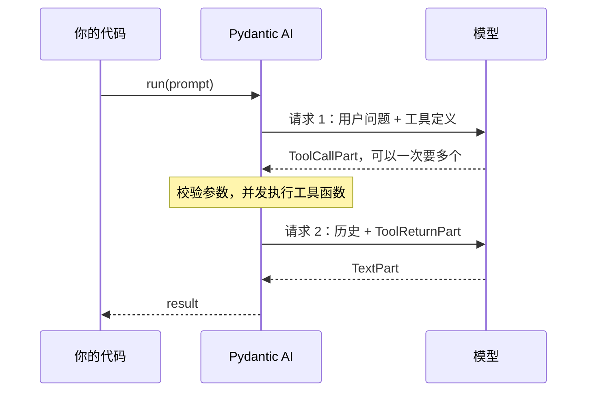

# 04 工具与依赖注入

[← 返回总目录](../../README.md)

前三章的模型只能生成内容。这一章让它调用你写的函数：查数据、算日期、下订单。五个示例依次回答五个问题：

| 示例 | 回答的问题 |
|---|---|
| [01_first_tool.py](./01_first_tool.py) | 怎么把一个普通函数交给模型调用？ |
| [02_tool_schema.py](./02_tool_schema.py) | 模型到底看到了什么？ |
| [03_deps.py](./03_deps.py) | 工具怎么拿到「当前用户」「数据库连接」这类每次运行才有的东西？ |
| [04_tool_errors.py](./04_tool_errors.py) | 工具出错了怎么办？ |
| [05_stream_tool_events.py](./05_stream_tool_events.py) | 怎么边跑边看到工具的调用和结果？ |

基于 Pydantic AI 2.73.0。文中的输出都是实际运行结果（省略了开头的标题行），模型回答的具体文字每次会不同。标注「本地实测」的内容，是用假模型 `FunctionModel` 固定住模型行为后得到的。

## 1. 心智模型

带工具的 run 是一个循环，就是你在 Rust 里手写过的那个，现在全部在 `agent.run()` 里面跑完：



模型和工具之间隔着两道边界，本章的内容都围绕它们：

```
模型 → 工具    模型只看得到 工具名、说明、参数 schema；它传来的参数是不可信输入，先校验再执行
你的代码 → 工具  deps 由你在 run 时传入，模型看不到也改不了
```

| Pydantic AI | JS / Rust 里像什么 |
|---|---|
| `@agent.tool_plain` | Vercel AI SDK 的 `tool({ description, execute })`；Rust 里手写的工具定义加上按名字 `match` 分发 |
| 函数签名 + docstring | 工具的 JSON Schema。Rust 里要 `#[derive(JsonSchema)]` 再手动拼 |
| `RunContext[Deps]` | axum 的 `State<T>`、Express 的 `req`、React 的 Context |
| `raise ModelRetry("…")` | 回一条带错误标记的 tool result，让模型重新调用 |
| `UsageLimits(request_limit=5)` | 手写循环里的 `max_steps` |

协议层你已经熟悉，这里只对一下名字（OpenAI 规范接口，本地 mock 抓取）：

| Pydantic AI | 请求体里 |
|---|---|
| 工具定义 | `tools[].function`：`name`、`description`、`parameters` |
| `ToolCallPart` | assistant 消息的 `tool_calls[]`，`arguments` 是 JSON 字符串 |
| `ToolReturnPart` | 一条 `role: "tool"` 的消息，`content` 是返回值的 JSON 文本 |
| 出错的 `ToolReturnPart` | 同上，`content` 包了一层：`{"error": …}` |

## 2. 前置知识

本章新出现的 Python 语法：

| 写法 | 含义 | JS / Rust 对照 |
|---|---|---|
| `@agent.tool(retries=2)` | 带参数的装饰器：先调用 `agent.tool(retries=2)` 得到真正的装饰器，再用它包函数 | 返回装饰器的高阶函数；带参数的属性宏 |
| `"""说明\n\nArgs:\n    x: …"""` | Google 风格 docstring，`Args:` 下面逐个写参数说明 | JSDoc 的 `@param` / `///` 文档注释 |
| `@dataclass` | 按字段注解自动生成 `__init__` 等方法，不做校验 | Rust 的 struct；TS 里只有字段的 class |
| `RunContext[Deps]` | 泛型，方括号里是类型参数 | `RunContext<Deps>` |
| `[p for p in items if cond]` | 带条件的列表推导 | `items.filter(...)` / `.iter().filter(..).collect()` |
| `sorted(xs, key=lambda p: p.price)[:n]` | 按 key 排序后切出前 n 个，返回新列表 | `[...xs].sort(...).slice(0, n)` / `sort_by` 后 `truncate` |
| `f"{x!r}"` | 用 `repr()` 格式化，字符串会带上引号 | Rust 的 `{:?}` |
| `isinstance(part, ToolReturnPart)` | 运行时类型判断 | `instanceof` / `if let` |
| `date.today().weekday()` | 周一是 0，周日是 6 | JS 的 `getDay()` 是周日为 0 |

## 3. 示例讲解

### 3.1 [01_first_tool.py](./01_first_tool.py)：第一个工具

```bash
uv run examples/04_tools_and_deps/01_first_tool.py
```

```python
agent = Agent(
    model,
    instructions="请使用简短中文来回答。涉及日期时必须用工具，不要自己推算。",
)


@agent.tool_plain
def get_today() -> str:
    """获取今天的日期和星期。"""
    today = date.today()
    return f"{today.isoformat()} 星期{WEEKDAYS[today.weekday()]}"


@agent.tool_plain
def days_until(target: date) -> int:
    """计算从今天到目标日期还有多少天。

    Args:
        target: 目标日期，格式 YYYY-MM-DD
    """
    return (target - date.today()).days


resp = await agent.run("今天星期几？距离2027年元旦还有多久？")
```

要点：

- **`@agent.tool_plain` 注册一个不需要运行上下文的工具。** 函数名是工具名，docstring 是工具说明，类型注解是参数 schema。
- **参数先校验再执行。** 模型传来的是 JSON 字符串 `"2027-01-01"`，框架按注解转成 `date` 对象后才调用函数，函数里不用自己解析。
- **返回值不必是 `str`。** `int`、`dict`、`list`、dataclass、pydantic 对象都行，框架转成 JSON 文本发给模型。
- **普通 `def` 就够用。** 框架把它放到线程池里跑，不会卡住事件循环；函数里要 `await` 时再写成 `async def`。
- **注册了工具，模型不一定用。** 它可能觉得自己能算，所以在 `instructions` 里点名要求。

实际输出：

```
用户      今天星期几？距离2027年元旦还有多久？
模型→调用  get_today({})
模型→调用  days_until({"target":"2027-01-01"})
框架→返回  get_today = '2026-11-25 星期三'
框架→返回  days_until = 37
模型      今天是2026年11月25日，星期三。距离2027年元旦还有37天。
用量：RunUsage(cost=Decimal('0.001428'), input_tokens=329, output_tokens=77, requests=2, tool_calls=2)
```

从这段输出能读出三件事：

- **两个调用挨在一起，是并行工具调用。** 模型在一条响应里要了两个工具，框架并发执行后把两个结果一起发回。所以 `tool_calls=2`，`requests` 仍然是 2 而不是 3。
- **`requests=2`。** 每多一轮工具往返就多一次模型请求，并且每次都带着完整历史和全部工具定义。
- **消息历史比前几章多了两种 part：**

```
ModelRequest:   UserPromptPart
ModelResponse:  ToolCallPart × 2
ModelRequest:   ToolReturnPart × 2
ModelResponse:  TextPart
```

#### 参数传错时

让假模型先传 `{"target": "明年元旦"}`，再传正确的日期（本地实测）：

```
ModelResponse:  ToolCallPart     days_until({"target":"明年元旦"})
ModelRequest:   ToolReturnPart   outcome=retried  [{'type': 'date_from_datetime_parsing', 'loc': ['target'], 'msg': 'Input should be a valid date or datetime, invalid character in year', 'input': '明年元旦'}]
ModelResponse:  ToolCallPart     days_until({"target":"2027-01-01"})
ModelRequest:   ToolReturnPart   outcome=success  36
```

函数第一次根本没有执行，这次 run 的用量是 `requests=3, tool_calls=1`。校验错误作为工具结果发回了模型，和上一章输出校验失败走的是同一条路。重试次数的规则见 3.4。

### 3.2 [02_tool_schema.py](./02_tool_schema.py)：模型看到的工具定义

```bash
uv run examples/04_tools_and_deps/02_tool_schema.py
```

```python
def search_products(
    category: Literal["键盘", "鼠标", "显示器"],
    keyword: str = "",
    max_price: float | None = None,
    limit: int = 3,
) -> list[Product]:
    """在商品目录里按分类搜索商品，按价格从低到高返回。

    Args:
        category: 商品分类
        keyword: 商品名里要包含的关键词，留空表示不限
        max_price: 价格上限（元），不限价格时不传
        limit: 最多返回几条
    """
    ...


agent = Agent(model, tools=[search_products], instructions="…")

# 换成假模型跑一次，不发请求，只看框架本来要发给模型的工具定义
await agent.run("随便问点什么", model=FunctionModel(show_what_model_sees))
```

模型看不到函数体。它看到的三样东西全部从函数本身生成：

| 函数里写的 | 工具定义里变成 |
|---|---|
| 函数名 | `name` |
| docstring 里 `Args:` 之前的内容 | `description` |
| `Args:` 下的每一行 | 对应参数的 `description` |
| `Literal[...]` | `enum` |
| `float \| None` | `anyOf: [number, null]` |
| 没有默认值 | 进入 `required` |
| 有默认值 | 不在 `required` 里，`default` 写进 schema |

实际打印的工具定义（压缩了换行）：

```json
{
  "additionalProperties": false,
  "properties": {
    "category": { "description": "商品分类", "enum": ["键盘", "鼠标", "显示器"], "type": "string" },
    "keyword": { "default": "", "description": "商品名里要包含的关键词，留空表示不限", "type": "string" },
    "max_price": { "anyOf": [{ "type": "number" }, { "type": "null" }], "default": null, "description": "价格上限（元），不限价格时不传" },
    "limit": { "default": 3, "description": "最多返回几条", "type": "integer" }
  },
  "required": ["category"],
  "type": "object"
}
```

要点：

- **写工具就是写提示词。** 类型注解和 docstring 是给模型看的。工具定义每次请求都会带上并计入 input tokens，所以说明要准确，但不要写长。
- **能用 `Literal` 就别用 `str`。** 模型只能从列出的值里选，传别的会被打回。
- **`tools=[...]` 和装饰器等价。** 区别是函数不绑定在某个 Agent 上，可以给多个 Agent 复用。框架看第一个参数是不是 `RunContext` 来判断它要不要上下文。
- **`FunctionModel` 是用你写的函数冒充模型。** 框架把本来要发出去的消息和工具定义交给它，它的返回值就是「模型的回复」。`run(..., model=...)` 只对这一次生效。

schema 是要求，校验才是保证。假模型传不同参数时的结果（本地实测）：

| 模型传的参数 | 结果 |
|---|---|
| `{"category": "耳机"}` | 打回：`Input should be '键盘', '鼠标' or '显示器'` |
| `{"category": "鼠标", "color": "red"}` | 打回：`Extra inputs are not permitted` |
| `{"keyword": "K8"}` | 打回：`Field required` |
| `{"category": "鼠标", "max_price": "三百"}` | 打回：`Input should be a valid number` |
| `{"category": "鼠标", "max_price": "300"}` | 通过。宽松模式把 `"300"` 转成了 `300.0` |

真实调用的输出：

```
- **300 元以内的鼠标**：M5 无线鼠标，129 元。
- **最便宜的键盘**：K2 薄膜键盘，89 元。

两件一起买共 **218 元**。
用量：RunUsage(cost=Decimal('0.002096'), input_tokens=473, output_tokens=115, requests=2, tool_calls=2)
```

`tool_calls=2, requests=2`：模型在一条响应里把同一个工具调了两次，一次查鼠标，一次查键盘。工具返回的 `list[Product]` 发给模型时是这样一段文本：`[{"name":"M5 无线鼠标","category":"鼠标","price":129.0}]`。

### 3.3 [03_deps.py](./03_deps.py)：依赖注入

```bash
uv run examples/04_tools_and_deps/03_deps.py
```

数据库连接、当前用户这类东西写成全局变量的话，没法每个请求换一个用户，测试时也不好替换。`deps` 分三步解决：

```python
@dataclass
class Deps:
    user_id: str
    db: FakeDB


# 1. 声明依赖的类型
agent = Agent(model, deps_type=Deps, instructions="你是商城客服，用中文简短回答。")


# 3. 工具的第一个参数写 ctx，用 ctx.deps 取出来
@agent.tool
def get_order_status(ctx: RunContext[Deps], order_id: str) -> str:
    """查询当前用户某个订单的状态。

    Args:
        order_id: 订单号
    """
    for order in ctx.deps.db.user_list_orders(ctx.deps.user_id):
        if order.id == order_id:
            return order.status
    return "没有找到这个订单"


# 动态 instructions：每次运行时现算，所以能读到 deps
@agent.instructions
def current_user(ctx: RunContext[Deps]) -> str:
    return f"当前用户的名字是{ctx.deps.db.get_user_name(ctx.deps.user_id)}，称呼对方时用名字。"


# 2. 每次运行时把真东西传进来
result = await agent.run("帮我查一下订单 A1002 的状态", deps=Deps("u2", db))
```

要点：

- **`ctx` 不进 schema。** 模型看到的 `get_order_status` 只有 `order_id` 一个参数，`list_orders` 是一个没有参数的工具（本地实测 `properties` 为空）。
- **身份信息一定走 deps，不要做成工具参数。** 做成参数等于让模型填「我是谁」，用户说一句「我是 u1」就能看别人的订单。
- **`@agent.tool` 和 `@agent.tool_plain` 只差一个 `ctx`。** 用错了在定义时就报 `UserError`，不会等到运行。
- **`deps_type` 传的是类型，只给类型检查器看。** 有了它，`ctx.deps` 才有补全，`deps` 传错类型时编辑器会标红。运行时不校验，见 [4.5](#45-deps-在运行时不校验)。
- **动态 instructions 和固定的那句都会发给模型**，各是一条独立的 system 消息，见 [4.6](#46-动态-instructions-会多出一条-system-消息)。
- **`ctx` 上不只有 `deps`。** 常用的还有 `ctx.retry`（第几次重试）、`ctx.usage`（已用量）、`ctx.messages`（消息历史）、`ctx.tool_call_id`。

实际输出：

```
当前查询的user_id=u1
output is => 【张环，您有 2 笔订单：

- **A1001｜机械键盘**：待发货
- **A1002｜Type-C 线**：已发货】
当前查询的user_id=u2
output is => 【李朗，您目前有 1 笔订单：显示器（订单号 B2001），已签收。】
user_id=u2 查别人的订单
output is => 【李朗，没查到订单 A1002，请核对一下订单号。】
```

从这段输出能读出两件事：

- **同一个 agent、同一个问题，换一个 `deps` 就换了一个用户。** agent 仍然是模块级的无状态对象，每次运行不同的东西全在 `deps` 里。
- **第三段的权限是代码管住的。** A1002 是 u1 的订单。工具只在 `ctx.deps.user_id` 自己的订单里找，所以一定查不到，不靠提示词要求模型「别乱查」。查不到和「不是你的」返回同一句话，不泄露别人的订单是否存在。

### 3.4 [04_tool_errors.py](./04_tool_errors.py)：工具出错

```bash
uv run examples/04_tools_and_deps/04_tool_errors.py
```

工具的结局分五种，区别在于模型接下来看到什么：

| 情况 | 工具里怎么写 | 模型看到 | `outcome` |
|---|---|---|---|
| 正常结果，包括「查不到」 | `return` | 返回值 | `success` |
| 参数类型不对 | 不用写，框架校验 | pydantic 的校验错误 | `retried` |
| 换个参数还能成功 | `raise ModelRetry("…")` | 你写的那句话 | `retried` |
| 换什么参数都不行 | `raise ToolFailed("…")` | 你写的那句话 | `failed` |
| 代码 bug、不该让模型知道的错误 | 其他任何异常 | 看不到，整个 run 直接抛出 | 无 |

```python
@agent.tool(retries=2)
def book_room(ctx: RunContext, room: Literal["A", "B", "C"], hour: int) -> str:
    """预订会议室，每次预订 1 小时。 …"""
    if room in MAINTENANCE:
        raise ToolFailed(f"{room} 会议室维修中，本周无法预订。")

    if hour in BOOKED[room]:
        free = [h for h in range(9, 18) if h not in BOOKED[room]]
        raise ModelRetry(f"{room} 会议室 {hour} 点已被占用，空闲的开始时间：{free}")

    BOOKED[room].add(hour)
    return f"已预订 {room} 会议室 {hour}:00-{hour + 1}:00"


@agent.tool_plain
def export_schedule() -> str:
    """导出本周的会议室日程表。"""
    raise RuntimeError("导出服务连接失败")
```

要点：

- **括号里的消息是写给模型看的。** 说清楚错在哪、接下来能怎么做。`ModelRetry` 里带上了空闲时段，模型才知道该改成几点。
- **`ModelRetry` 和 `ToolFailed` 都不会让程序崩溃**，它们变成一条发回模型的工具结果。普通异常才会从 `run` 里抛出来。
- **`RunContext` 不带方括号**：这个 Agent 没有声明 `deps_type`，用 `@agent.tool` 只是为了读 `ctx.retry`。
- **`ToolReturnPart.outcome`** 记录了每次调用的结局，可以用来做监控和统计。

实际输出：

```
ModelRetry  帮我订 A 会议室下午 2 点，被占了就往后顺延到最近的空档。
  book_room(room='A', hour=14) retry=0
  book_room(room='A', hour=15) retry=1
A 会议室 14:00 已被占用，已顺延至最近的空档 15:00–16:00，预订成功。
  book_room → outcome=retried
  book_room → outcome=success
ToolFailed  帮我订 C 会议室上午 10 点。
  book_room(room='C', hour=10) retry=0
C 会议室本周维修，上午 10 点未能订上。要改订同一时间的 A 或 B 会议室吗？
  book_room → outcome=failed
普通异常  导出本周日程表
run 直接抛出了异常：RuntimeError: 导出服务连接失败
```

从这段输出能读出三件事：

- **`ModelRetry` 之后模型改了参数。** 14 点被占，它从返回的空闲列表里选了 15 点，`ctx.retry` 从 0 变成 1。
- **`ToolFailed` 之后模型没有再调用**，而是把失败告诉用户并给出替代方案。怎么办由模型决定。
- **普通异常时模型没有机会说话。** 调用方必须自己 `try`。

#### 重试次数

| 规则 | 说明 |
|---|---|
| 默认 1 次 | 每个工具各算各的 |
| 校验失败和 `ModelRetry` 共用一个计数 | 不是各 N 次 |
| `ToolFailed` 不占次数 | 本地实测连续 6 次 `ToolFailed`，run 正常结束 |
| 用完之后 | `run` 抛 `UnexpectedModelBehavior: Tool 'book_room' exceeded max retries count of 2` |

次数在三个层级设置，越具体的越优先（本地实测工具级的 2 压过了 run 级的 5）：

| 写法 | 作用范围 |
|---|---|
| `@agent.tool(retries=2)` | 这一个工具 |
| `agent.run(..., retries={"tools": 3})` | 这一次 run |
| `Agent(..., retries={"tools": 3})` | 这个 Agent 的所有 run |

### 3.5 [05_stream_tool_events.py](./05_stream_tool_events.py)：流式工具事件

```bash
uv run examples/04_tools_and_deps/05_stream_tool_events.py
```

第 2 章说过带工具时要用 `run_stream_events`，当时 `case _: pass` 跳过的就是这两个事件：

| 事件 | 什么时候出现 | 上面带着什么 |
|---|---|---|
| `FunctionToolCallEvent` | 参数校验完，工具即将执行 | `part`：`ToolCallPart` |
| `FunctionToolResultEvent` | 工具执行完 | `part`：`ToolReturnPart` |

做聊天界面时，它们对应「正在查询天气…」和「查询完成」。

```python
@agent.tool_plain
async def get_weather(city: str) -> str:
    """查询某个城市今天的天气。 …"""
    await asyncio.sleep(1)  # 模拟一次耗时 1 秒的网络请求
    return WEATHER.get(city, "没有这个城市的数据")


async with agent.run_stream_events(
    "北京、上海、广州今天哪个城市最适合户外跑步？",
    usage_limits=UsageLimits(request_limit=5, tool_calls_limit=10),
) as events:
    async for event in events:
        match event:
            case FunctionToolCallEvent(part=part):
                console.print(f"{elapsed()} 调用 {part.tool_name}({part.args_as_json_str()})")
            case FunctionToolResultEvent(part=part):
                console.print(f"{elapsed()} 结果 {part.tool_name} → {part.content}")
            case PartStartEvent(part=TextPart(content=content)):
                print(content, end="", flush=True)
            case PartDeltaEvent(delta=TextPartDelta(content_delta=delta)):
                print(delta, end="", flush=True)
            case AgentRunResultEvent(result=result):
                console.print(f"{elapsed()} 结束，用量：{result.usage}")
            case _:
                pass
```

要点：

- **两个事件之间的时间就是工具的执行时间。** 调用事件里的参数已经完整，不用自己拼 `ToolCallPartDelta`。
- **`part.tool_call_id` 用来把结果对回调用。** 并行时结果事件的顺序不等于调用顺序，见 [4.3](#43-并行调用的四个细节)。
- **`UsageLimits` 给一次运行设上限**，防止模型陷入反复调工具的循环。超限时抛 `UsageLimitExceeded`。

实际输出：

```
 3.2s 调用 get_weather({"city":"北京"})
 3.2s 调用 get_weather({"city":"上海"})
 3.2s 调用 get_weather({"city":"广州"})
 4.2s 结果 get_weather → 晴，2°C，西北风 4 级
 4.2s 结果 get_weather → 小雨，11°C
 4.2s 结果 get_weather → 多云，22°C，微风
今天**广州最适合户外跑步**：多云、22°C、微风，体感更舒适。北京虽晴，但只有 2°C，西北风 4 级；上海 11°C、有小雨，路面可能湿滑
 7.0s 结束，用量：RunUsage(…, input_tokens=304, output_tokens=124, requests=2, tool_calls=3)
```

从这段输出能读出两件事：

- **三个工具是并发执行的。** 每个要 1 秒，三个调用同时在 3.2s 开始，同时在 4.2s 结束，一共只花了 1 秒。
- **是否并行由模型决定。** 这次模型在一条响应里要了三个工具，所以 `requests=2`。模型一个一个调的话（本地实测），工具部分是 3 秒，`requests=4`。

## 4. 进阶与踩坑

### 4.1 docstring 的三个细节

本地实测：

| 写法 | 结果 |
|---|---|
| `Args:` 之前写了两段 | 两段都进 `description`，不是只取第一段 |
| `Args:` 里的参数名和签名不一致 | 这个参数的说明被丢掉，不报错 |
| 没有 docstring | `description` 是 `None`，模型只能靠函数名猜 |

第二种最难发现。加上 `@agent.tool_plain(require_parameter_descriptions=True)`，有参数缺说明时会在定义时报 `UserError: Missing parameter descriptions for city`。

工具名和说明也可以不从函数取：`@agent.tool_plain(name="weather", description="…")`。同一个 Agent 上工具重名，在定义时就报 `UserError: Tool name conflicts with existing tool`。

### 4.2 重试计数是「连续失败」

计数在工具成功一次后清零。本地实测 `retries=2` 的 `book_room`，按 成功、失败、成功、失败、成功、失败、成功 的顺序调用，累计失败 3 次，run 正常结束，`ctx.retry` 在 0 和 1 之间来回。

所以 `retries` 限制不住「失败和成功交替」的循环，也限制不住 `ToolFailed`。这两种情况靠 `UsageLimits` 兜底。

模型调用了不存在的工具时，框架同样回一条 `retried`，并把可用的工具名列给它：`Unknown tool name: 'cancel_room'. Available tools: 'book_room', 'export_schedule'`。

### 4.3 并行调用的四个细节

本地实测：

- **结果事件按完成顺序到达，消息历史按调用顺序排列。** 三个耗时 0.6s、0.2s、0.4s 的调用，结果事件的顺序是 0.2、0.4、0.6，历史里是 0.6、0.2、0.4。
- **同步工具也能并发。** 三个 `time.sleep(1)` 的 `def` 工具一共花了 1 秒，它们各自跑在线程池的线程里。所以同步工具里碰共享状态要考虑线程安全。
- **一个工具抛普通异常，同一批的其他工具会被取消。** 实测另外两个 `await asyncio.sleep(0.3)` 的工具都没有执行完。有副作用的工具（下单、发消息）不要指望同批的调用「要么都成、要么都不成」。
- **不想并发时**，给工具加 `sequential=True`，它会单独执行。实测三个 0.5 秒的调用依次在 0.5s、1.0s、1.5s 完成。要让一段代码里所有工具都串行，用 `with agent.parallel_tool_call_execution_mode("sequential"):`。

### 4.4 `UsageLimits` 的三个细节

- **不传也有上限。** 默认 `request_limit=50`，其他限制默认不开。实测一个永远在调工具的假模型，请求了 50 次后抛 `UsageLimitExceeded`。
- **`tool_calls` 只统计成功执行的。** 实测全是 `ToolFailed` 的 run，用量里没有 `tool_calls`；3.1 参数传错的那次 run，两次调用只记了 `tool_calls=1`。
- **`tool_calls_limit` 在一批工具执行之前检查。** 实测上限是 2、模型一次要了 3 个：直接抛 `The next tool call(s) would exceed the tool_calls_limit of 2 (tool_calls=3)`，三个工具一个都没有执行。

`UsageLimits` 还能限制 token 和费用：`input_tokens_limit`、`output_tokens_limit`、`total_tokens_limit`、`cost_limit`。

### 4.5 `deps` 在运行时不校验

本地实测：

| 写法 | 结果 |
|---|---|
| `agent.run("…")`，忘了传 `deps` | `AttributeError: 'NoneType' object has no attribute 'db'` |
| `agent.run("…", deps="我不是 Deps")` | `AttributeError: 'str' object has no attribute 'db'` |

两种情况框架都没有拦，是第一次读 `ctx.deps.db` 时才出的错。03 示例里最先读它的是动态 instructions，所以模型一次都没被请求。这类错误靠类型检查提前发现：实测 pyright 对这两种写法都会报 `"None" is not assignable to "Deps"` 这样的错误。

### 4.6 动态 instructions 会多出一条 system 消息

03 示例发出去的请求里有两条 system 消息（本地 mock 抓取）：

```json
{ "role": "system", "content": "你是商城客服，用中文简短回答。" }
{ "role": "system", "content": "当前用户的名字是张环，称呼对方时用名字。" }
```

这和第 1 章 [4.4](../01_basic_call/README.md#44-第三方接口的两个兼容问题) 的 run 级追加指令是同一个问题：部分后端只接受一条 system 消息，会返回 400。

### 4.7 不联网测试工具

3.2 的假模型回的是文字。让它回一个 `ToolCallPart`，框架就会真的执行工具，于是可以不花钱、不联网地测试工具逻辑：

```python
def fake_model(messages: list[ModelMessage], info: AgentInfo) -> ModelResponse:
    if len(messages) == 1:  # 第一次请求：假装模型要调工具
        return ModelResponse(parts=[ToolCallPart("get_order_status", {"order_id": "A1002"})])
    return ModelResponse(parts=[TextPart("完成")])  # 拿到工具结果后：给出回答


result = await agent.run("查 A1002", model=FunctionModel(fake_model), deps=Deps("u2", FakeDB()))
returns = [p for m in result.all_messages() for p in m.parts if isinstance(p, ToolReturnPart)]
assert returns[0].content == "没有找到这个订单"
```

`agent.run` 藏在别的函数里、没法传 `model=` 时，用 `with agent.override(model=..., deps=...):` 在一段代码范围内整体替换。本章「本地实测」的结论都是这样得到的。

## 5. 速查

```python
from dataclasses import dataclass
from typing import Literal

from pydantic_ai import Agent, ModelRetry, RunContext, ToolFailed, UsageLimits
from pydantic_ai import FunctionToolCallEvent, FunctionToolResultEvent


@dataclass
class Deps:
    user_id: str
    db: Database


agent = Agent(model, deps_type=Deps, retries={"tools": 2})


# 不需要上下文
@agent.tool_plain
def search(category: Literal["键盘", "鼠标"], limit: int = 3) -> list[Product]:
    """工具说明，写给模型看。

    Args:
        category: 参数说明
        limit: 有默认值，模型可以不传
    """
    ...


# 需要上下文：第一个参数是 ctx，不进 schema
@agent.tool(retries=3)
async def book(ctx: RunContext[Deps], hour: int) -> str:
    """…"""
    if closed:
        raise ToolFailed("换什么参数都不行，说明原因")
    if taken:
        raise ModelRetry("哪里不对，可以改成什么")
    return ctx.deps.db.book(ctx.deps.user_id, hour)


# 动态 instructions
@agent.instructions
def who(ctx: RunContext[Deps]) -> str:
    return f"当前用户是 {ctx.deps.user_id}"


# 运行：deps 每次传入，usage_limits 兜底
result = await agent.run("…", deps=Deps("u1", db), usage_limits=UsageLimits(request_limit=5))

# 流式：带工具时用 run_stream_events
async with agent.run_stream_events("…", deps=Deps("u1", db)) as events:
    async for event in events:
        match event:
            case FunctionToolCallEvent(part=part):
                show_running(part.tool_call_id, part.tool_name)
            case FunctionToolResultEvent(part=part):
                show_done(part.tool_call_id, part.outcome)
            case _:
                pass
```

| 概念 | 一句话 |
|---|---|
| 工具定义 | 函数名、docstring、类型注解生成；模型只看得到这三样 |
| `@agent.tool_plain` / `@agent.tool` | 不带 / 带 `ctx`；`tools=[...]` 与装饰器等价 |
| 参数校验 | 先校验再执行，不通过时函数不运行，错误发回模型 |
| `deps` | `deps_type` 声明、`run(deps=...)` 传入、`ctx.deps` 取出；模型看不到 |
| 身份和权限 | 走 `deps`，由代码保证，不做成工具参数 |
| `return` / `ModelRetry` / `ToolFailed` / 其他异常 | 正常结果 / 让模型改参数重调 / 告诉模型失败了 / run 直接抛出 |
| `retries` | 默认 1；每个工具单独计连续失败次数；工具级 > run 级 > Agent 级 |
| 并行工具调用 | 模型一条响应要多个工具，框架并发执行；`sequential=True` 关闭 |
| `FunctionToolCallEvent` / `FunctionToolResultEvent` | 工具开始 / 结束，用 `tool_call_id` 配对 |
| `UsageLimits` | 默认 `request_limit=50`；超限抛 `UsageLimitExceeded` |
| `FunctionModel` | 用函数冒充模型，查看工具定义、不联网测试 |

---

上一章：[03 结构化输出](../03_structured_output/README.md)
