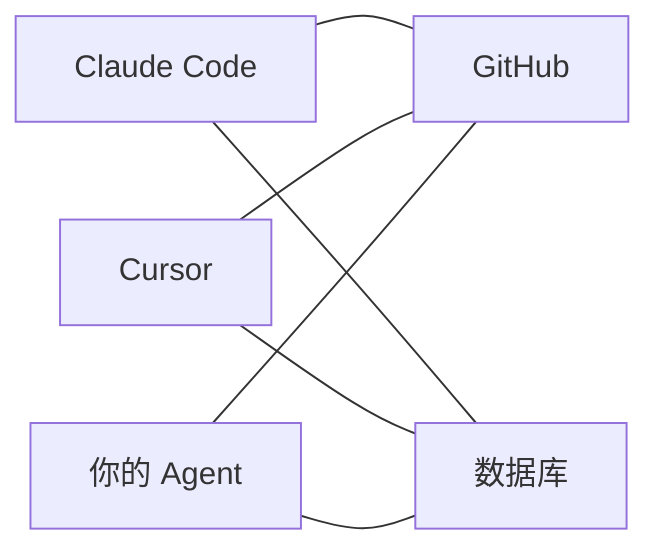
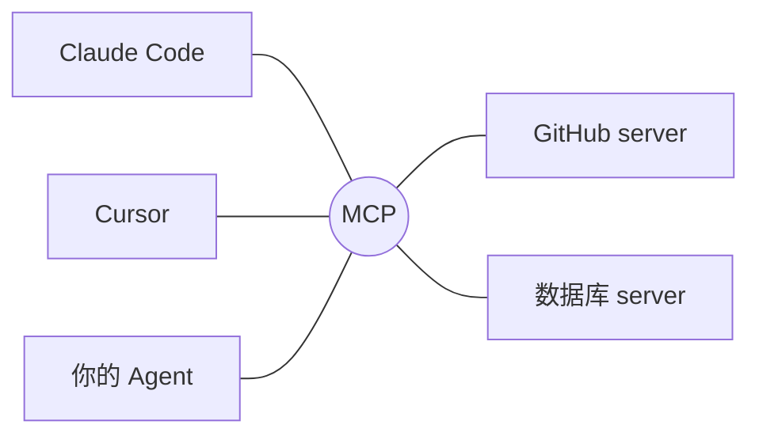
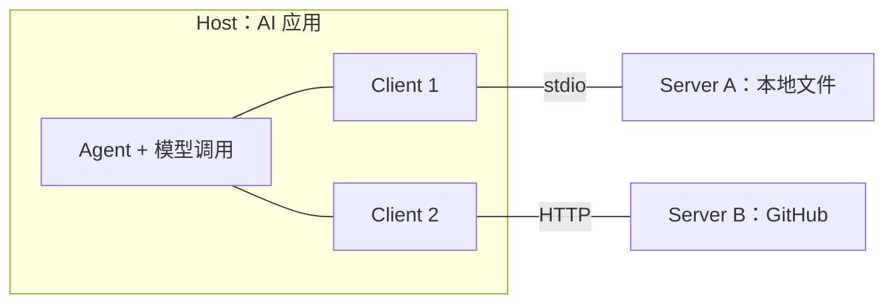
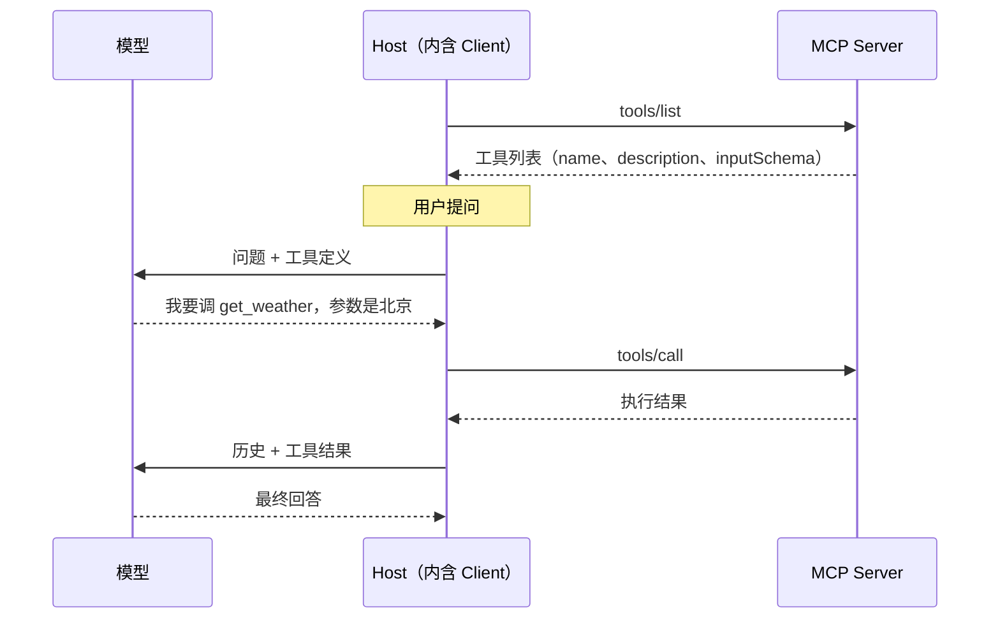

# 05 MCP 与 Skill · 01 什么是 MCP

[← 返回总目录](../../README.md)

这一篇只讲概念，不写代码。基于 MCP 规范 `2026-07-28`。

## 1. 一句话

MCP（Model Context Protocol）是一套开放协议，规定 **AI 应用怎么和外部的工具、数据通信**。Anthropic 在 2024 年 11 月开源。

你可以直接把它当成 **AI 工具界的 LSP**：

| | LSP | MCP |
|---|---|---|
| 写一次的东西 | rust-analyzer | GitHub server、数据库 server |
| 到处能用 | VS Code、Neovim、Zed | Claude Code、Cursor、你自己的 Agent |
| 底层 | JSON-RPC | JSON-RPC |

## 2. 它解决什么问题

第 4 章的工具是写在 Agent 代码里的函数。这有两个麻烦：

- 换一个应用，工具就得重写一遍。
- 别人写好的工具，你拿不过来用。

3 个应用接 2 个服务，要写 6 套对接：



有了 MCP，两边各实现一次协议就行，M × N 变成 M + N：



## 3. 三个角色



| 角色 | 是什么 | 在本项目里 |
|---|---|---|
| Host | 整个 AI 应用，负责调模型、管对话 | 你写的 Python 程序 |
| Client | Host 里的一个连接对象，一个 Client 只连一个 Server | Pydantic AI 的 `MCPToolset` |
| Server | 对外提供工具和数据的程序 | 别人写好的，或者你自己写的 |

Server 可以跑在本机，也可以跑在远程，叫法都是 Server。

## 4. Server 能提供什么

三样东西，区别在于**谁决定用它**：

| 原语 | 是什么 | 谁决定用 | 例子 |
|---|---|---|---|
| Tools | 可执行的函数 | 模型 | 查天气、写文件、发请求 |
| Resources | 只读的数据 | 应用 | 文件内容、数据库表结构 |
| Prompts | 提示词模板 | 用户 | 斜杠命令、菜单项 |

最常用的是 Tools，后面几篇也主要讲它。

反方向还有一个 **Elicitation**：Server 执行到一半，回头找用户要输入或确认，比如「确定删除吗？」。

## 5. 一次工具调用怎么走



**模型不知道 MCP 的存在。** 它看到的还是第 4 章那种工具定义，回的还是 tool call。MCP 只管 Host 和 Server 之间那两段。

所以和第 4 章比，只有两处不同：

| | 第 4 章 | MCP |
|---|---|---|
| 工具定义从哪来 | 函数签名 + docstring | `tools/list` 的返回 |
| 工具怎么执行 | 进程内调函数 | 发一次 `tools/call` |

线上的消息就是 JSON-RPC（省略了每个请求都要带的 `_meta`，里面是协议版本和客户端能力）：

```jsonc
// Client → Server
{ "jsonrpc": "2.0", "id": 3, "method": "tools/call",
  "params": { "name": "get_weather", "arguments": { "city": "北京" } } }

// Server → Client
{ "jsonrpc": "2.0", "id": 3,
  "result": { "resultType": "complete", "content": [{ "type": "text", "text": "晴，2°C" }] } }
```

## 6. 两种传输

消息内容一样，区别只在怎么送：

| | stdio | Streamable HTTP |
|---|---|---|
| Server 在哪 | 本机，Host 把它当子进程拉起来 | 远程，一个 HTTP 服务 |
| 怎么传 | 写 stdin、读 stdout，一行一条消息 | HTTP POST，需要流式时响应走 SSE |
| 服务几个 Client | 一个 | 很多个 |
| 鉴权 | 不需要，靠环境变量传密钥 | Bearer token、OAuth |

写 stdio server 有一条铁律：**stdout 只能输出协议消息**，日志一律写 stderr。一句 `print` 就能把连接搞坏。

## 7. 看老教程会踩的坑

`2026-07-28` 这版改动很大，协议变成了**无状态**。网上大部分教程还是旧版：

| 老教程里写的 | 现在 |
|---|---|
| 先 `initialize` 握手再干活 | 没有握手。每个请求自带版本和能力，想提前问就调 `server/discover` |
| `Mcp-Session-Id` 会话 | 删了。要跨调用保存状态，Server 自己发一个句柄当工具参数传 |
| Server 主动向 Client 发请求 | 删了。Server 在结果里说「我还需要 xx」，Client 带上答案重发原请求 |
| HTTP+SSE 传输 | 废弃，用 Streamable HTTP |
| Roots、Sampling 两个客户端能力 | 废弃，新代码别用 |

## 8. 什么时候用

- **工具只给自己这一个 Agent 用**：第 4 章的函数工具就够了，更简单。
- **想用别人写好的 server，或者想让自己的工具被 Claude Code、Cursor 用**：上 MCP。

接第三方 server 之前记住一点：它的工具说明会原样进到模型上下文里，等于让别人往你的提示词里写东西。**只接信得过的 server。**

---

上一章：[04 工具与依赖注入](../04_tools_and_deps/README.md) ｜ 下一篇：[02 Streamable HTTP 详解](./02_streamable_http.md)
