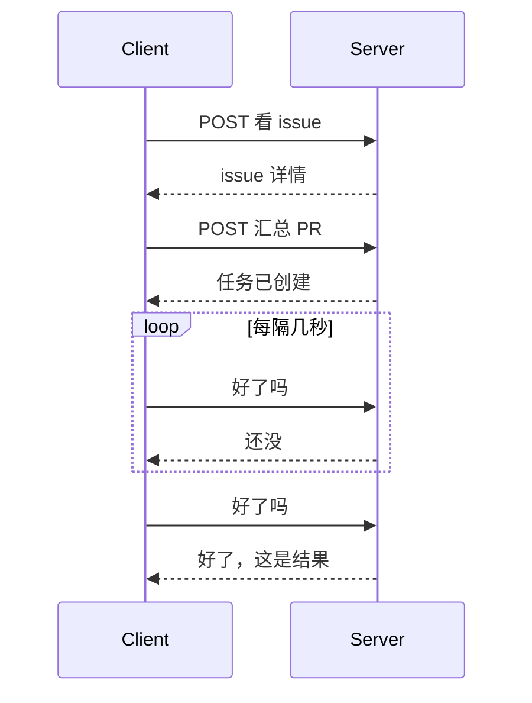
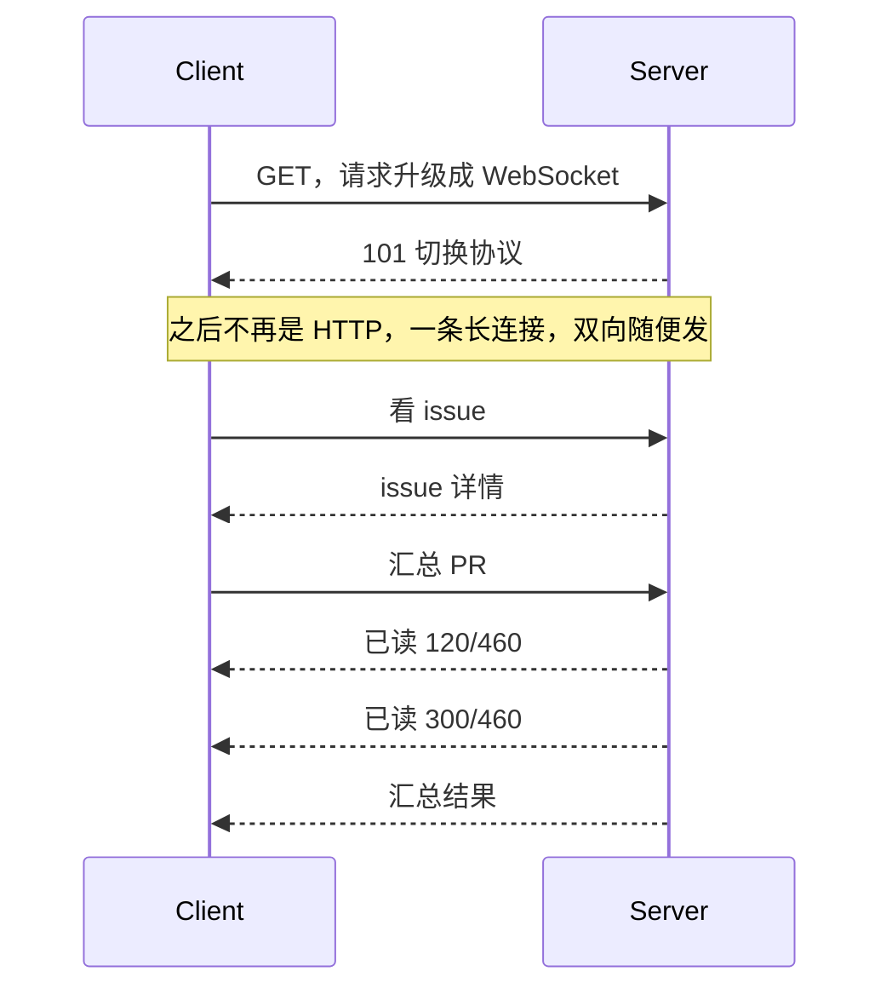
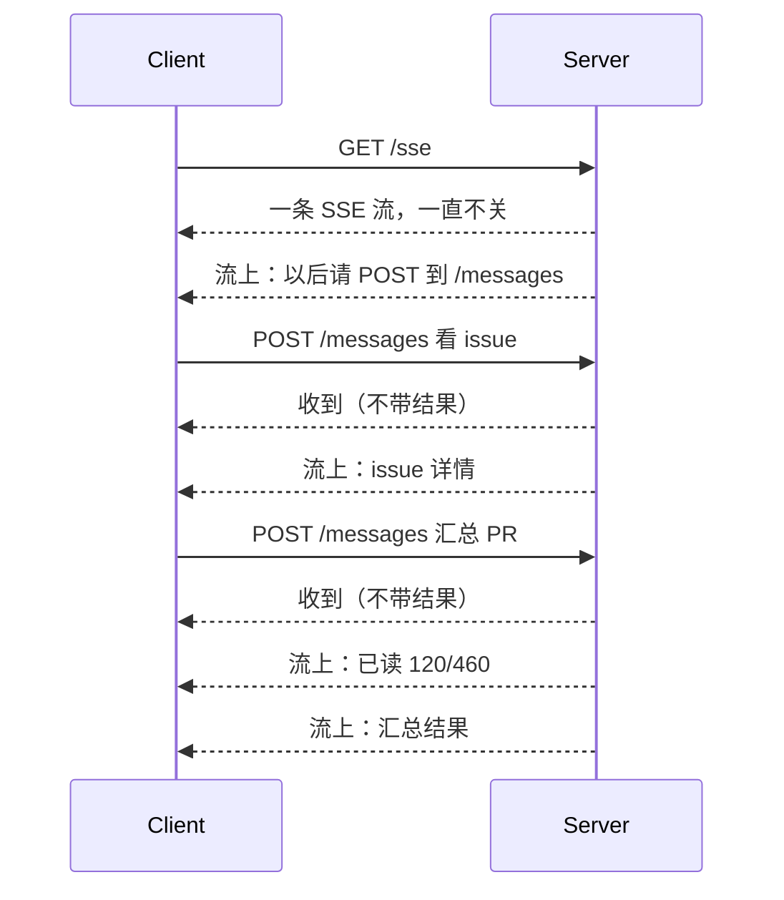
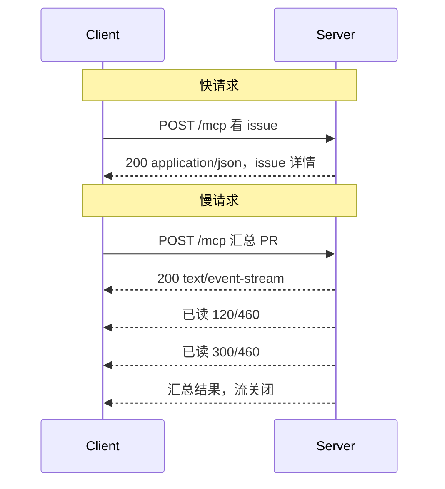

# 05 MCP 与 Skill · 02 Streamable HTTP 详解

[← 返回总目录](../../README.md)

这一篇不背规范，只回答一个问题：**远程 MCP 的传输方式，为什么最后长成了 Streamable HTTP。** 下一篇手写。

## 1. 先看需求

stdio 只能连本机的 server。Server 放到远程以后，两边用什么通信？

拿一句话当例子。用户在 Claude 里接了 GitHub 的 MCP server，说：

> 帮我看下 #42 这个 issue，再把最近 3 个月合进 main 的 PR 汇总一下

模型会调两次工具，这两次的脾气完全不同：

| | 第 1 件：看 issue | 第 2 件：汇总 PR |
|---|---|---|
| 耗时 | 几百毫秒 | 几百个 PR 一个个读，可能要一分钟 |
| 用户想看到 | 结果 | 进度，「已读 120 / 460」 |

所以传输方式要同时满足：

1. **快请求**：一问一答，越简单越好。
2. **慢请求**：执行过程中 server 能往回推消息。
3. **好部署**：就是个普通 web 服务，能过网关、能带 `Authorization`、能放 serverless。

候选只有三个：普通 HTTP、WebSocket、SSE。

## 2. 方案一：普通 HTTP



第 1 件事完美。第 2 件事只有两条路，都不好：

- **干等**：一分钟没动静，用户以为卡死了，中间的代理还可能超时把连接掐掉。
- **轮询**：多出一堆请求，server 还得把任务状态存起来，进度也不是实时的。

**结论：快请求满分，慢请求不行。**

## 3. 方案二：WebSocket



功能上全满足。但官方在提案（[PR #206](https://github.com/modelcontextprotocol/modelcontextprotocol/pull/206)）里专门写了一节「Why not WebSocket」，三个理由：

| 官方理由 | 大白话 |
|---|---|
| 大多数调用只是 RPC，都走 WebSocket 会带来 "a lot of unnecessary operational and network overhead" | 看个 issue 也得先建一条长连接，还要一直维护它 |
| 浏览器里 "there is no way to attach headers (like `Authorization`)" | `new WebSocket(url)` 没有传请求头的地方，token 放不进去 |
| 只有 GET 能升级成 WebSocket，POST 要分两步，"introducing complexity and latency" | 想用 POST 发请求，就得先 POST 再升级 |

还有一个部署上的问题：长连接天生有状态。连接在哪台机器上，后面的消息就只能找那台，serverless 也挂不住。

**结论：慢请求满分，但为了少数慢请求，让所有快请求都背上长连接的成本。**

## 4. 方案三：SSE

SSE 也是 server 往 client 推，但它就是一个普通的 HTTP 响应，只是 body 不结束，一段一段往外写。所以网关、鉴权、请求头全都照常用。

它的问题是**单向**，只能 server → client。

MCP 第一版（`2024-11-05`）的做法是用 POST 补上另一个方向，叫 **HTTP+SSE**，要两个端点：



注意结果不从 POST 回来，全都从那条长连接回来。于是：

- **哪怕只调一个快工具，也得先挂一条长连接。**
- **Server 有多台时很麻烦。** POST 打到 B 机器，长连接在 A 机器，B 得想办法把结果转给 A。
- **长连接一断，路上的消息就丢了**，没法续传。

**结论：这是用 SSE 拼出了一个 WebSocket，WebSocket 的毛病一个没少。**

## 5. 换个思路：一个请求开一条 SSE

问题不在 SSE，在「一条连接管所有请求」。

那就反过来，**每个请求自己开一条流**：请求从 POST 进去，响应从同一个 POST 回来，只是响应体变成了 SSE。进度一条条推，最后一条是结果，然后流关闭。

这其实就是你调 LLM 流式接口的写法：`fetch` 发 POST，读 `response.body`。

连接跟着请求走，请求结束连接就没了。「哪台机器持有连接」这个问题直接消失。

## 6. 再省一步：快请求不开流

看个 issue 也走 SSE 就多余了。那就让 **server 自己挑**：

- 一下就能答完，回 `application/json`。
- 要边跑边推，回 `text/event-stream`。

Client 在请求头里写 `Accept: application/json, text/event-stream`，意思是两种我都接得住。



这就是 **Streamable HTTP**：2025 年 3 月的提案，写进了 `2025-03-26` 版规范，替换掉 HTTP+SSE。

| | 普通 HTTP | WebSocket | HTTP+SSE | Streamable HTTP |
|---|---|---|---|---|
| 快请求一问一答 | ✅ | ❌ 先建连接 | ❌ 先建连接 | ✅ |
| 慢请求推进度 | ❌ | ✅ | ✅ | ✅ |
| 浏览器里能带请求头 | ✅ | ❌ | ✅ | ✅ |
| 不用维护长连接 | ✅ | ❌ | ❌ | ✅ |

## 7. 实测：server 真的是按请求挑的

用 `curl` 打一个 FastMCP 4.2.5 测试 server。工具 `slow_count(n)` 每 0.5 秒报一次进度，模拟「汇总 PR」。

请求长这样：

```http
POST /mcp HTTP/1.1
Content-Type: application/json
Accept: application/json, text/event-stream
MCP-Protocol-Version: 2026-07-28
Mcp-Method: tools/call
Mcp-Name: slow_count

{
  "jsonrpc": "2.0", "id": 4, "method": "tools/call",
  "params": {
    "name": "slow_count",
    "arguments": { "n": 3 },
    "_meta": {
      "io.modelcontextprotocol/protocolVersion": "2026-07-28",
      "io.modelcontextprotocol/clientCapabilities": {}
    }
  }
}
```

后三个请求头是把 body 里的版本、方法、工具名抄了一遍，给网关看的：不解析 body 就能路由和限流。

**原样发出去**，1.5 秒后一次性拿到 JSON：

```
Content-Type: application/json

{"jsonrpc":"2.0","id":4,"result":{…"content":[{"text":"数完了 3","type":"text"}]…}}
```

**在 `_meta` 里加一句 `"progressToken": "p1"`**（`id` 换成 5），意思是「我要看进度」，同一个工具的响应就变成了 SSE（左边是收到的时间）：

```
 0.5s | Content-Type: text/event-stream
 0.5s |
 0.5s | event: message
 0.5s | data: {"jsonrpc":"2.0","method":"notifications/progress","params":{"progressToken":"p1","progress":1.0,"total":3.0}}
 1.0s | event: message
 1.0s | data: {"jsonrpc":"2.0","method":"notifications/progress","params":{"progressToken":"p1","progress":2.0,"total":3.0}}
 1.5s | event: message
 1.5s | data: {"jsonrpc":"2.0","method":"notifications/progress","params":{"progressToken":"p1","progress":3.0,"total":3.0}}
 1.5s | event: message
 1.5s | data: {"jsonrpc":"2.0","id":5,"result":{…"content":[{"text":"数完了 3","type":"text"}]…}}
```

每个 `data:` 是一条完整的 JSON-RPC 消息。没有 `id` 的是通知，带 `id` 的那条是最终结果，收到它流就结束。

## 8. 后来又砍了一刀

`2025-03-26` 那版为了让 server 能主动找 client，还留着几样带状态的东西。`2026-07-28` 把它们全删了：

| `2025-03-26` 留着的 | `2026-07-28` |
|---|---|
| `initialize` 握手 + `Mcp-Session-Id` 会话 | 删了。每个请求在 `_meta` 里自带版本和能力 |
| GET 开一条独立的长流，收 server 的主动消息 | 删了。要收「工具列表变了」这类通知，就 POST 一个 `subscriptions/listen`，它的响应是一条长流 |
| Server 在流上反过来向 client 发请求 | 删了。Server 在结果里说「我还需要 xx」，client 带上答案重发一次 |
| `Last-Event-ID` 断点续传 | 删了。流断了就换个 `id` 重发 |

三个版本是同一个方向：**一路在删「连接上的状态」**。

| 版本 | 远程传输 |
|---|---|
| `2024-11-05` | HTTP+SSE：两个端点，一条长连接 |
| `2025-03-26` | Streamable HTTP：一个端点，JSON 或 SSE，session 可选 |
| `2026-07-28` | Streamable HTTP：彻底无状态 |

实测现在的样子。真实客户端（FastMCP `Client`）连上、列工具、调一次 `add`，server 一共只收到三个互不相干的 POST：

```
POST  mcp-method=server/discover           → 200 application/json
POST  mcp-method=tools/list                → 200 application/json
POST  mcp-method=tools/call  mcp-name=add  → 200 application/json
```

三个请求打到三台不同的机器上也没问题。

取消也不用发消息了，**断开连接就是取消**。实测 `slow_count(10)`，1.3 秒时客户端断开，server 端日志：

```
[tool] count 1/10
[tool] count 2/10
[tool] CANCELLED
```

---

上一篇：[01 什么是 MCP](./01_what_is_mcp.md) ｜ 下一篇：[03 手写 Streamable HTTP](./03_streamableHttp_impl.md)
