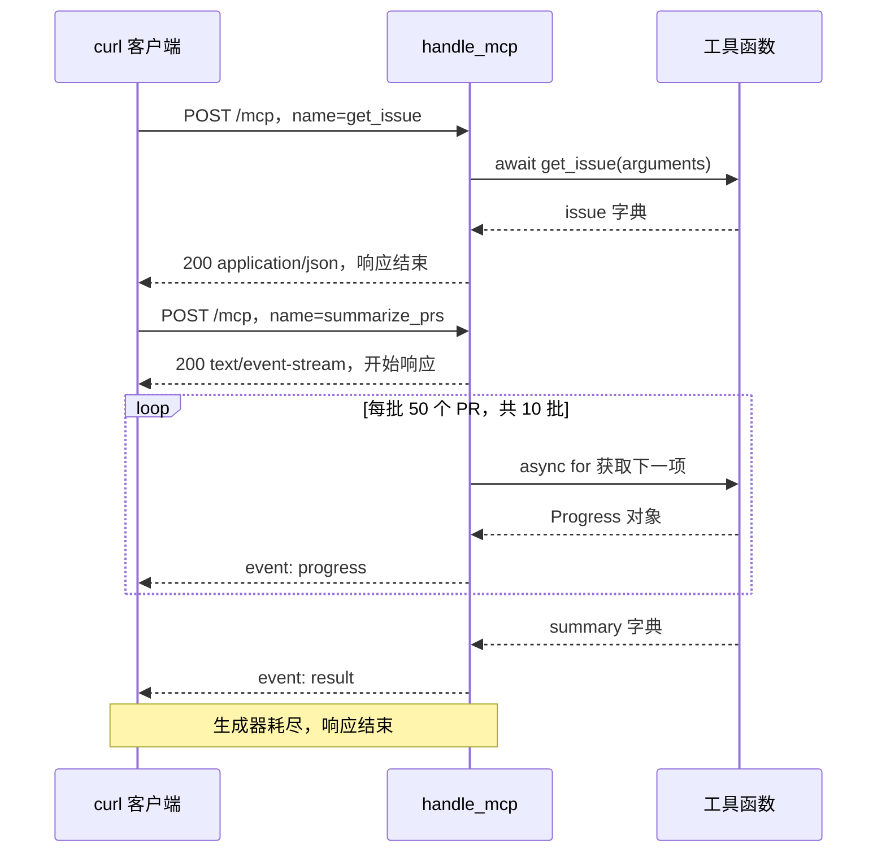

# 05 MCP 与 Skill · 03 手写 Streamable HTTP 传输演示

[← 返回总目录](../../README.md)

上一篇解释了为什么同一个 HTTP 请求可以直接返回 JSON，也可以返回 SSE。这一篇把它写出来：**用 FastAPI 接收工具调用，让快工具一次性返回结果，让慢工具边执行边报告进度。**

代码在 [streamable_http_server/main.py](./03_streamable_http_demo/streamable_http_server/main.py)。整个示例只有一个服务端文件，两个工具共用 `POST /mcp`：

| 工具 | 做什么 | 返回方式 |
|---|---|---|
| `get_issue` | 从内存中查 issue 22 | 一次性返回 JSON |
| `summarize_prs` | 模拟读取 500 个 PR，再给出汇总 | SSE：10 条进度 + 1 条最终结果 |

本篇演示传输机制，消息格式由示例自己定义，尚未实现标准 MCP 的 JSON-RPC 消息、工具发现等能力，因此暂时不能直接接入标准 MCP 客户端。文中的输出是根据当前代码给出的**预期结果**，可按第 4 节自行验证。

## 1. 心智模型

一次请求从头到尾只用一个 HTTP 响应。区别在于响应体什么时候结束：



代码里分了三层：

| 层次 | 对应代码 | 负责什么 |
|---|---|---|
| 工具逻辑 | `get_issue`、`summarize_prs` | 查询数据、产出进度和结果 |
| 消息编码 | `stream_tool_call`、`sse` | 把 Python 对象转成 SSE 文本 |
| HTTP 接口 | `handle_mcp` | 读取请求、查找工具、选择响应类型 |

**工具里的 `yield` 产出的是 Python 对象。** 外层把对象编码成 SSE 文本，再由 `StreamingResponse` 和 Uvicorn 发到网络上。工具函数本身没有操作连接。

## 2. 前置知识

### 2.1 协程和异步生成器

两个工具都用 `async def`，调用方式却不同，原因是函数体里有没有 `yield`：

| 写法 | 调用时得到什么 | 怎么取结果 | JS / Rust 对照 |
|---|---|---|---|
| `async def` + `return` | 协程对象 | `await f(args)` | `Promise<T>` / `Future<Output = T>` |
| `async def` + `yield` | 异步生成器对象 | `async for item in f(args)` | `async function*` / 异步 `Stream` |

调用 `summarize_prs(args)` 只会创建生成器，等外层开始迭代时，函数体才开始执行。每次 `yield` 把当前项交出去，下一次迭代再从暂停处继续。

### 2.2 本篇用到的类型和框架对象

| 写法 | 含义 |
|---|---|
| `@dataclass` | 根据字段自动生成初始化等方法；不会自动校验字段类型 |
| `asdict(progress)` | 把 dataclass 实例转成字典，供 JSON 序列化使用 |
| `Callable[[dict[str, Any]], T]` | 接收一个字典参数、返回 `T` 的函数 |
| `Awaitable[T]` | 可以 `await`，等待后得到 `T` 的对象 |
| `AsyncIterator[T]` | 可以通过 `async for` 逐项取出 `T` 的对象 |
| `Progress \| dict[str, Any]` | 每一项可能是进度对象，也可能是结果字典 |
| `Request` | FastAPI 收到的 HTTP 请求，可以读取请求头和请求体 |
| `JSONResponse` | 将数据编码成 JSON，作为完整响应返回 |
| `StreamingResponse` | 迭代传入的数据源，把产出的内容逐段写入响应体 |

`await request.json()` 只负责解析 JSON。当前接口直接接收 `Request`，没有声明 Pydantic 请求模型，因此工具参数不会自动获得类型和范围校验。

## 3. 示例讲解

### 3.1 两个工具：一个返回结果，一个逐项产出

快工具直接从 `FAKE_ISSUES` 里查数据：

```python
async def get_issue(args: dict[str, Any]) -> dict[str, Any]:
    issue_id = args.get("issue_id")
    issue = FAKE_ISSUES.get(issue_id)
    if issue is None:
        return {"error": f"id 为{issue_id}的 issue 不存在"}
    return {"issue_id": issue_id, **issue}
```

`**issue` 把查到的字段展开到结果字典中。这里的键是整数，所以测试时传 `22`，字符串 `"22"` 不会匹配。

慢工具每隔一秒产出一条进度，最后再产出汇总：

```python
@dataclass
class Progress:
    done: int
    total: int
    message: str


TOTAL = 500


async def summarize_prs(args: dict[str, Any]) -> AsyncIterator[Progress | dict[str, Any]]:
    months = args.get("months", 3)
    for done in range(50, TOTAL + 1, 50):
        await asyncio.sleep(1)
        yield Progress(done, TOTAL, f"已读 {done} / 共{TOTAL} 个PR")
    yield {"summary": f"最近{months}个月合并进main分支的{TOTAL}个 PR功能 210 个，修复 200个，其他90个"}
```

这段代码有三个时间点：

- 大约 1 秒后，第一条进度是 `done=50`。
- 大约 10 秒后，第十条进度是 `done=500`，随后立即产出汇总。
- 汇总产出后，再次迭代时生成器结束。

`range` 的结束值不包含在序列中，所以写 `TOTAL + 1`，才能让 500 也被取到。

`asyncio.sleep(1)` 用来模拟耗时 I/O，等待期间会让出事件循环。`months` 只影响最终文案，PR 数量和分类数量都是固定的模拟数据，没有实际访问 GitHub，也没有调用模型。

### 3.2 工具注册表：决定用 await 还是 async for

```python
@dataclass
class Tool:
    handler: Callable[[dict[str, Any]], Awaitable[dict[str, Any]]] | Callable[[dict[str, Any]], AsyncIterator[Any]]
    streaming: bool


TOOLS = {
    "get_issue": Tool(get_issue, False),
    "summarize_prs": Tool(summarize_prs, True),
}
```

请求里的工具名先到 `TOOLS` 查找，再根据 `streaming` 选择调用方式：

| `streaming` | `handler` 应当返回 | 外层如何调用 |
|---|---|---|
| `False` | 可等待的结果 | `await tool.handler(args)` |
| `True` | 异步迭代器 | `async for item in tool.handler(args)` |

这里是**注册时人为指定响应方式**。代码没有测量工具耗时，也没有读取客户端的 `progressToken`；`summarize_prs` 每次都会走 SSE。这与上一篇 FastMCP 按请求需求选择响应方式的例子有所区别。

### 3.3 SSE 编码：一个事件就是一段有格式的文本

```python
def sse(event: str, data: dict[str, Any]) -> str:
    """拼一个 SSE 事件：event 区分类型，data 放 JSON"""
    return f"event: {event}\ndata: {json.dumps(data, ensure_ascii=False)}\n\n"
```

产出的文本形如：

```text
event: progress
data: {"done": 50, "total": 500, "message": "已读 50 / 共500 个PR"}

```

`event:` 是事件类型，`data:` 是事件内容，**末尾的空行表示这个事件结束**。`ensure_ascii=False` 让中文保持可读；JSON 编码会转义字符串内部的换行，因此本例的 JSON 可以放在一条 `data:` 行里。

`stream_tool_call` 负责把工具产出的两种对象映射到两种事件。核心循环如下，日志和异常处理省略：

```python
async def stream_tool_call(tool_name: str, tool: Tool, args: dict[str, Any]) -> AsyncIterator[str]:
    async for item in tool.handler(args):
        if isinstance(item, Progress):
            yield sse("progress", asdict(item))
        else:
            yield sse("result", item)
```

两个生成器各有分工：内层 `summarize_prs` 产出业务对象，外层 `stream_tool_call` 产出 SSE 字符串。

`progress`、`result` 都是本例约定的名称。`result` 这个名字本身不会关闭响应；本例是在最终结果之后不再产出内容，框架迭代结束，响应才结束。

### 3.4 一个端点，选择两种响应

接口先取工具名和参数：

```json
{"name": "get_issue", "arguments": {"issue_id": 22}}
```

`handle_mcp` 的核心逻辑如下，省略了日志：

```python
@app.post("/mcp")
async def handle_mcp(request: Request) -> Response:
    body = await request.json()
    tool_name = body.get("name")
    args = body.get("arguments", {})
    tool = TOOLS.get(tool_name)
    if tool is None:
        return JSONResponse({"error": f"工具 {tool_name} 不存在"}, status_code=404)
    if not tool.streaming:
        return JSONResponse({"result": await tool.handler(args)})
    return StreamingResponse(
        stream_tool_call(tool_name, tool, args),
        media_type="text/event-stream",
        headers={"Cache-Control": "no-cache", "X-Accel-Buffering": "no"},
    )
```

JSON 分支先等待工具完成，然后构造响应。SSE 分支先构造 `StreamingResponse`，框架随后消费生成器、持续写入响应体。

三个响应头分别解决不同问题：

| 响应头 | 作用 |
|---|---|
| `Content-Type: text/event-stream` | 告诉客户端按 SSE 格式解释响应体，由 `media_type` 设置 |
| `Cache-Control: no-cache` | 要求缓存复用响应前先重新验证；不等于禁止存储 |
| `X-Accel-Buffering: no` | 提示 Nginx 关闭响应缓冲；其他代理不一定识别这个头 |

客户端通过响应的 `Content-Type` 决定如何读取数据。示例中的 `Accept: application/json, text/event-stream` 表达两种格式都能接受，不过当前服务端没有校验这个请求头。

### 3.5 客户端断开后，取消怎么传进来

`stream_tool_call` 把整个迭代过程放在 `try` 中，捕获取消信号：

```python
try:
    async for item in tool.handler(args):
        ...  # 编码并产出 SSE 事件
except asyncio.CancelledError:
    print(f"Server {tool_name}: 客户端关掉了流，停止干活")
    raise
```

在项目当前的 Uvicorn/Starlette 组合下，框架监听客户端断开，并取消流式任务。任务如果正等待 `asyncio.sleep(1)`，取消会从这个等待点传播出来，进入上述异常分支。

这里的 `raise` 保留取消信号，让框架继续完成清理。`CancelledError` 也可能来自服务关闭等其他取消原因，日志中的文字针对本例的断开测试场景。

取消依赖异步任务有机会处理信号。如果把工具改成长时间的同步计算或阻塞调用，事件循环被占住，其他请求和断开处理都会受到影响。

## 4. 运行与测试

以下命令都在项目根目录执行。示例只使用本机模拟数据，不需要配置模型、`.env` 或 API Key。

### 4.1 启动服务

首次运行先安装项目依赖，之后启动脚本：

```bash
uv sync
uv run examples/05_mcp_skill/03_streamable_http_demo/streamable_http_server/main.py
```

服务监听 `127.0.0.1:8900`。保持这个终端运行，另开终端发送请求；测试结束后，在服务端终端按 `Ctrl-C` 停止。

### 4.2 快请求：一次性返回 JSON

```bash
curl -i -sS http://127.0.0.1:8900/mcp \
  -H 'Content-Type: application/json' \
  -H 'Accept: application/json, text/event-stream' \
  -d '{"name":"get_issue","arguments":{"issue_id":22}}'
```

`-d` 会让 curl 发送 POST，`-i` 显示响应头，`-sS` 隐藏传输进度条但保留错误信息。

预期状态码是 200，`Content-Type` 是 `application/json`，响应体如下，为便于阅读进行了换行：

```json
{
  "result": {
    "issue_id": 22,
    "title": "登录偶发500",
    "state": "open",
    "author": "jak",
    "comments": 8
  }
}
```

### 4.3 慢请求：逐条接收 SSE

```bash
curl -i -N -sS http://127.0.0.1:8900/mcp \
  -H 'Content-Type: application/json' \
  -H 'Accept: application/json, text/event-stream' \
  -d '{"name":"summarize_prs","arguments":{"months":3}}'
```

新增的 **`-N` 关闭 curl 的输出缓冲**，方便观察内容逐步到达。

预期状态码是 200，`Content-Type` 是 `text/event-stream`，可能附带 `charset=utf-8`。响应体的开头和结尾如下，中间的进度事件省略：

```text
event: progress
data: {"done": 50, "total": 500, "message": "已读 50 / 共500 个PR"}

event: progress
data: {"done": 100, "total": 500, "message": "已读 100 / 共500 个PR"}

...

event: progress
data: {"done": 500, "total": 500, "message": "已读 500 / 共500 个PR"}

event: result
data: {"summary": "最近3个月合并进main分支的500个 PR功能 210 个，修复 200个，其他90个"}

```

验证时看三件事：进度大约每秒出现一次；`done` 从 50 到 500，共 10 条；最后只有一条 `result`，随后 curl 退出，总耗时约 10 秒。实际到达间隔会受调度和网络缓冲影响。

### 4.4 中途断开：确认服务端停止执行

```bash
curl -i -N -sS --max-time 2.5 http://127.0.0.1:8900/mcp \
  -H 'Content-Type: application/json' \
  -H 'Accept: application/json, text/event-stream' \
  -d '{"name":"summarize_prs","arguments":{"months":3}}'
```

`--max-time 2.5` 让 curl 在 2.5 秒后结束请求，通常能收到前两条进度。curl 的超时错误和退出码 28 是这次测试的预期行为。

回到服务端终端，应看到类似日志：

```text
Server 【summarize_prs】 推进度: 已读 50 / 共500 个PR
Server 【summarize_prs】 推进度: 已读 100 / 共500 个PR
Server summarize_prs: 客户端关掉了流，停止干活
```

继续观察几秒，确认这次请求不再产出进度，也没有最终汇总。测试时只运行这一条流，避免其他请求的同名日志混在一起。

### 4.5 并发：慢请求执行时，快请求还能响应

在一个终端执行 4.3 的完整流式请求，同时在另一个终端执行 4.2 的 issue 查询。

预期 issue 查询很快返回，此时 PR 汇总还在继续。这个测试验证 `asyncio.sleep()` 等待期间确实让出了事件循环。

### 4.6 异常输入：观察当前实现的边界

替换 4.2 命令中 `-d` 后面的请求体，可以检查以下行为。表中描述的是当前代码的预期表现，其中的 500 和流中断是待完善的错误处理。

| 请求体 | 当前预期表现 |
|---|---|
| `{"name":"unknown"}` | HTTP 404，返回工具不存在 |
| `{"name":"get_issue","arguments":{"issue_id":999}}` | HTTP 200，业务错误放在 `result.error` 中 |
| `{"name":"get_issue","arguments":{"issue_id":"22"}}` | HTTP 200，字符串键匹配不到整数键，返回 issue 不存在 |
| `{"name":"get_issue","arguments":null}` | 工具调用 `.get()` 时抛异常，HTTP 500 |
| `{"name":"summarize_prs","arguments":null}` | 已发送 HTTP 200 响应头，生成器执行时报错，流异常中断 |
| `[]` | 请求体没有 `.get()` 方法，HTTP 500 |
| `{` | JSON 解析失败，当前没有对应的异常处理，HTTP 500 |

## 5. 进阶与踩坑

### 5.1 `/mcp` 这个路径本身不会带来协议兼容

要接入标准 MCP 客户端，还需要实现约定的消息格式和方法。本例与前两篇介绍的协议存在这些差异：

| 项目 | 当前 demo | 标准 MCP 的对应内容 |
|---|---|---|
| 工具调用 | 顶层 `name`、`arguments` | JSON-RPC `tools/call`，参数放在 `params` 中 |
| 调用关联 | 没有请求 ID | 用 JSON-RPC `id` 关联请求和响应 |
| 工具发现 | 只有进程内的 `TOOLS` 字典 | `tools/list`，提供名称、说明和输入 schema |
| SSE 数据 | 自定义 `progress`、`result` 事件 | `message` 事件，数据是 JSON-RPC 消息 |
| 进度 | 直接发送 `done`、`total` | `notifications/progress`，关联请求中的 `progressToken` |
| 工具结果 | 任意结果字典 | 符合协议的工具调用结果结构 |

后续接入时还要处理协议版本、客户端能力、请求头和错误响应等要求。当前阶段使用 curl 按本例格式测试即可。

### 5.2 类型注解不等于参数校验

`args: dict[str, Any]` 不会阻止客户端传 `null`、列表或错误字段。`body.get("arguments", {})` 只在键缺失时使用默认字典；显式传 `null`，拿到的仍然是 `None`。

后续可以用 Pydantic 模型校验请求体及各工具参数。例如要求 `issue_id` 为整数、`months` 为正整数，并在创建流式响应之前完成校验。

另外，`Tool.handler` 的联合类型和独立的 `streaming: bool` 没有建立类型关联。当前写法会让 Pyright 在 `async for` 和 `await` 两处报错，`issue_id` 可能为 `None` 也会触发类型错误。正常注册的两个工具在运行时配对正确，但静态检查仍需要完善；可以通过两个工具类型配合 `Literal[True/False]` 表达这种关联。

### 5.3 流开始以后，HTTP 状态码已经发出

`StreamingResponse` 会先发送状态码和响应头，再开始读取生成器。工具在读取过程中抛出普通异常时，服务端已经无法把这次响应改为 HTTP 500。

当前只处理了取消异常，普通异常会造成流中断。后续需要约定流中的错误消息，并让客户端把「收到最终结果」作为成功标志；只收到 HTTP 200 或看到连接结束，都不足以证明工具执行成功。

### 5.4 收到一个网络分片，不一定收到一个完整事件

服务器一次 `yield` 的字符串，经过网络后可能被拆成多段；多次 `yield` 也可能合并到同一个接收分片。

自己写客户端时，需要持续读取响应体，累积并解析完整 SSE 事件，再读取 `data` 中的 JSON。不能对每个原始网络分片直接做一次 `json.loads()`。

浏览器端可以用 `fetch` 发 POST，再流式读取 `response.body`。原生 `EventSource` 使用 GET，不能直接发送本例要求的 POST 请求体。在地址栏打开 `/mcp` 同样发送 GET，得到 405 是预期行为。

## 6. 速查

| 概念 | 本例中的对应关系 |
|---|---|
| 服务地址 | `http://127.0.0.1:8900/mcp`，只监听本机 |
| 请求格式 | `{"name":"工具名","arguments":{...}}` |
| 普通工具 | `async def` + `return`，用 `await` 获取结果 |
| 流式工具 | `async def` + `yield`，用 `async for` 获取每一项 |
| JSON 路径 | `get_issue` → `JSONResponse` |
| SSE 路径 | `summarize_prs` → `stream_tool_call` → `StreamingResponse` |
| 进度和结果 | `Progress` → `event: progress`；字典 → `event: result` |
| SSE 事件结束 | 空行，即 `\n\n` |
| HTTP 响应结束 | 生成器耗尽，框架结束响应体 |
| 实时观察 | curl 加 `-N`，关闭输出缓冲 |
| 测试取消 | curl 加 `--max-time 2.5`，观察服务端是否停止产出 |
| 当前范围 | HTTP/SSE 传输演示，使用自定义消息格式 |

---

上一篇：[02 Streamable HTTP 详解](./02_streamable_http.md)
